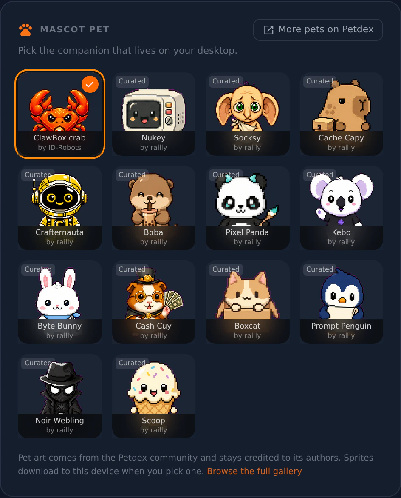
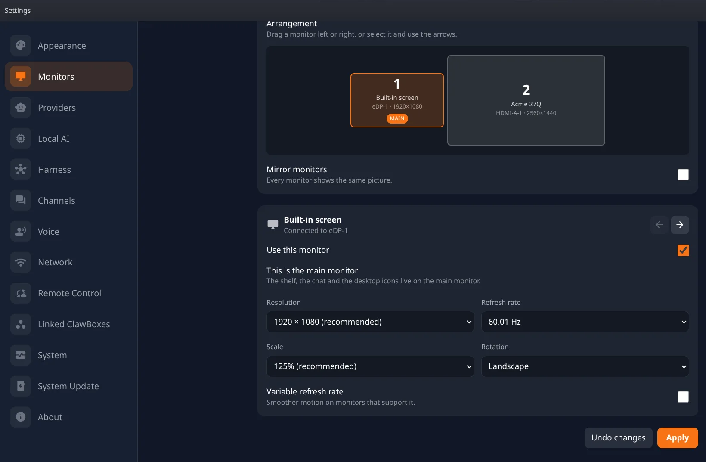
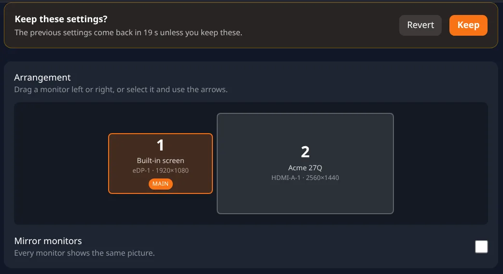
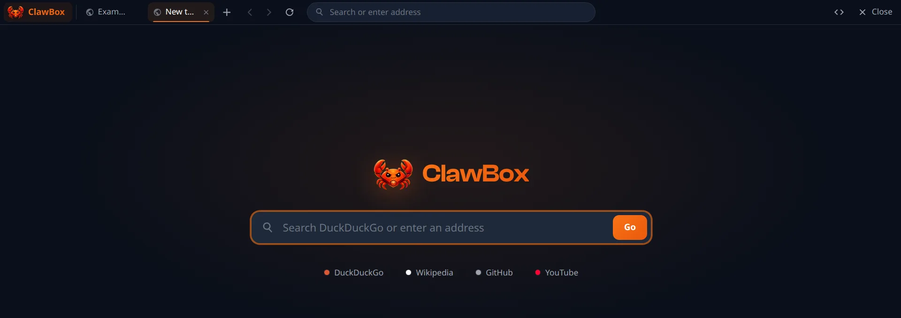
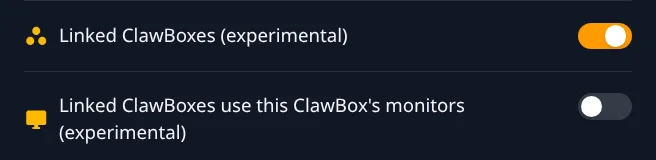
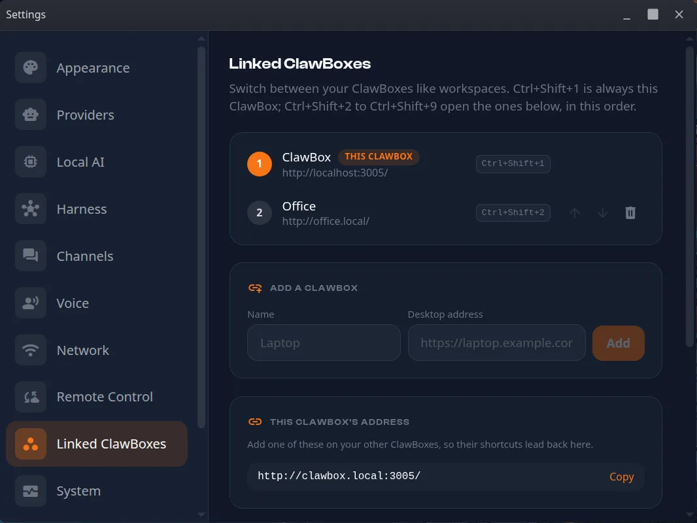

**Settings → Appearance** is where the desktop's look is set, and the page Settings opens on.
Everything here is per-device and survives updates.

## Wallpaper

Four things ship on the box, and you can upload your own picture beside them.

| Wallpaper | Offered on |
|---|---|
| **Lobster Orbital** | OpenClaw and dual — the default there, shown at half strength |
| **ClawBox** | OpenClaw and dual |
| **Hermes** | every edition — the default on Hermes |
| **Deep Space** | every edition |

A ClawBox running Hermes Agent shows no ClawBox artwork: that is another product's
branding. Wallpapers you upload yourself are on every edition.

Beside the picture you get **Fit Mode** (fill, fit or center), **Opacity** and a
**Background Color** the wallpaper is composited over.

**Upload** takes pictures only: another kind of file is refused with a message, and a stored
file that is not a picture shows the default wallpaper instead.

## The mascot

**Show Mascot** puts a companion on the desktop. Click it to open the chat panel; its
menu can send it to sleep or hide it.

## Mascot Pet

**Settings → Appearance → Mascot Pet** chooses the body your companion wears. It is on
every edition.

- The first tile is what your box wears with nothing picked. On a ClawBox running
  OpenClaw that is the **ClawBox crab**, which ships with the box: no download, works
  offline, and it cannot be removed. On a Hermes-edition box the first tile is **None** —
  an egg you can click to hatch a random pet.
- Every other tile is a community pet from the Petdex gallery. Picking one downloads its
  sprites **to your device**; they do not ship with ClawBox. Each tile is credited to
  whoever made it, and **Browse the full gallery** opens the whole collection.
- A pet needs an internet connection the first time you pick it, and works offline
  afterwards.

<Frame caption="Settings → Appearance → Mascot Pet, on a 4.3 box">
  
</Frame>

<Note>
On the Hermes edition, picking a pet writes through Hermes' own pet configuration — the
same store its CLI and dashboard read, so a pet chosen in a terminal moves this picker too.
</Note>

## Language

The desktop is translated into ten languages. Pick yours from the **Language** setting.

## Remote desktop resolution

**Settings → Appearance → Display → Remote desktop resolution** sets the size of the remote
desktop: **1280 × 720** (the default), **1600 × 900** or **1920 × 1080**. Changing it restarts
the remote desktop briefly and closes every app open on it, browser windows included, so you
are asked first. The choice is kept across restarts and updates. It does not apply while the
remote desktop mirrors a physical screen.

## Kiosk and monitor screens

A ClawBox installed on a computer can show its desktop full screen on the screens connected
to that computer. This part is for the owner who sits at that screen. It covers three
things, and each works the same on OpenClaw and on Hermes:

- **Monitor mode**: one desktop spread over a row of monitors.
- **Kiosk mode**: every web page the desktop opens gets a ClawBox bar with tabs.
- **Linked ClawBoxes** (experimental): switch between your ClawBoxes with one key press.

### Before you start

- **A ClawBox installed on a PC that shows its desktop full screen on a screen connected
  to it.** The ClawBox device has neither monitor mode nor kiosk mode. Linked ClawBoxes
  works there too, in an ordinary browser window (see the tip under
  [Switch between your ClawBoxes](#switch-between-your-clawboxes)).
- **The right session on that computer.** Kiosk mode is the **ClawBox Kiosk** session,
  and monitor mode is the **ClawBox Desktop** session. They are set up once on that
  computer; an update does not switch them on (see Details).
- **For Linked ClawBoxes: the owner account.** Other users do not see the page or the
  switches. You also need the address you open each other ClawBox's desktop with, for
  example `laptop.local` or `https://laptop.example.com`.

### Arrange your monitors

<Steps>
  <Step title="Open Settings → Monitors">
    **Monitors** is right under **Appearance**. Your monitors show as numbered blocks under
    **Arrangement**, side by side. Below them are the settings of the monitor you selected.
  </Step>
  <Step title="Put the blocks in the order of your desk">
    Drag a block left or right. You can also click a block and use the arrow buttons
    beside its name. When the desktop spans two or more monitors, **Identify** shows each
    monitor's number on it.
  </Step>
  <Step title="Choose the main monitor">
    Click the block of the monitor that should hold the shelf, then click **Make this the
    main monitor**. The block now says **Main**, and the line reads **This is the main
    monitor**. The shelf, the chat and the desktop icons live on the main monitor.
  </Step>
  <Step title="Set each monitor">
    With a block selected, choose its **Resolution**, **Refresh rate**, **Scale** and
    **Rotation** (**Landscape**, **Portrait**, **Landscape (flipped)** or **Portrait
    (flipped)**). The choice marked **(recommended)** suits that monitor best. To leave a
    monitor dark, untick **Use this monitor**.
    <Frame caption="Settings → Monitors with two monitors, the built-in screen selected">
      
    </Frame>
  </Step>
  <Step title="Click Apply">
    The monitors change, and a bar at the top asks **Keep these settings?** It counts down
    from 20 seconds: "The previous settings come back in 20 s unless you keep these."
    <Frame caption="The question after Apply">
      
    </Frame>
  </Step>
  <Step title="Click Keep">
    You see "Saved. These settings come back whenever these monitors are connected." If
    the picture is wrong, click **Revert**, or do nothing: after 20 seconds the previous
    settings come back on their own, and you see "The previous settings are back."
  </Step>
</Steps>

<Tip>
**Mirror monitors** shows the same picture on every monitor. **Brightness** appears for a
monitor whose brightness the box can change. **Undo changes** drops your changes before you
click **Apply**.
</Tip>

### Open web pages in the kiosk

This is kiosk mode only. In monitor mode there is no ClawBox bar: a page the desktop opens
comes up in an ordinary Chrome window, with Chrome's own tabs and address bar.

<Steps>
  <Step title="Open a web page from the desktop">
    Click **Web** on the desktop, or anything that opens a website. The page opens in a tab
    of its own, with the ClawBox bar along the top.
  </Step>
  <Step title="Use the bar">
    Each open page is a tab on the bar: click it to go there, or click its **×** to close
    it. Back, forward and reload come next. Type an address or a search in the middle,
    where it says **Search or enter address**.
  </Step>
  <Step title="Open a new tab">
    Click **+**. A ClawBox start page opens, with a search box (**Search DuckDuckGo or enter
    an address**) and links to DuckDuckGo, Wikipedia, GitHub and YouTube.
    <Frame caption="The ClawBox bar on the start page, with a second page open">
      
    </Frame>
  </Step>
  <Step title="Close the page">
    Click **Close** at the right end of the bar.
  </Step>
  <Step title="Go back to the desktop">
    Click **ClawBox** at the left end of the bar. On the desktop the same bar shows your
    open pages as tabs, and **+** opens a new one. The shelf also gathers the open pages
    under one **Web** icon, with a dot for each. Click it to go back to the page you used
    last.
  </Step>
</Steps>

### Switch between your ClawBoxes

<Steps>
  <Step title="Open the advanced options">
    On the ClawBox that runs the screen, open **Settings → System Update** and click
    **Advanced options**.
  </Step>
  <Step title="Turn on Linked ClawBoxes (experimental)">
    Turn on the switch **Linked ClawBoxes (experimental)**. Settings now has a page called
    **Linked ClawBoxes**.
    <Frame caption="Settings → System Update → Advanced options">
      
    </Frame>
  </Step>
  <Step title="Add your other ClawBox">
    Open **Settings → Linked ClawBoxes**. Under **Add a ClawBox**, type a **Name** and the
    other box's **Desktop address**, then click **Add**. The box joins the list with its
    key, **Ctrl+Shift+2**. You can add up to eight, on Ctrl+Shift+2 to Ctrl+Shift+9, and
    change their order with the arrows.
    <Frame caption="Settings → Linked ClawBoxes with one other box">
      
    </Frame>
  </Step>
  <Step title="Press Ctrl+Shift+2">
    In kiosk mode the other ClawBox's desktop opens in a tab of its own. Sign in there the
    first time. In monitor mode the same window goes to the other box instead, as in any
    other browser (see the tip below).
  </Step>
  <Step title="Press Ctrl+Shift+1 to come back">
    In kiosk mode Ctrl+Shift+1 always brings back this ClawBox, from any page. Every box
    stays open in its own tab, so switching back and forth is instant.
  </Step>
</Steps>

<Note>
Both switches are off until you turn them on. Turn them off the same way. The second one,
**Linked ClawBoxes use this ClawBox's monitors (experimental)**, changes nothing on a
ClawBox set up the standard way, so you can leave it off. It needs kiosk mode and monitor
mode on the same screen, and a screen runs one or the other (see Details).
</Note>

<Tip>
In monitor mode, and in any other browser such as Chrome on your laptop, the keys work
too, but the same window goes to the other box's desktop. To come back with Ctrl+Shift+1,
the other box needs this version of ClawBox and **Linked ClawBoxes (experimental)** turned
on as well, with this
ClawBox in its own list: copy an address under **This ClawBox's address** and add it there.
</Tip>

### If it does not work

- **Settings has no Monitors page.** This ClawBox does not run the ClawBox Desktop
  session. That is the case on every ClawBox device and on a computer that shows the
  kiosk instead.
- **A monitor went dark after Apply.** Wait 20 seconds: the previous settings come back on
  their own.
- **Ctrl+Shift+2 does nothing.** Check that **Linked ClawBoxes (experimental)** is on, on
  the box that runs the screen. "Nothing on Ctrl+Shift+2 yet" means that place in the list
  is empty: add a box in **Settings → Linked ClawBoxes**. Inside an app window that shows
  another website the keys go to that website, so click the desktop first.
- **"Enter the address of the other ClawBox's desktop".** Type the address you open the
  other box's desktop with in a browser, such as `laptop.local` or
  `https://laptop.example.com`.

### Details

- Monitor mode runs only while the ClawBox Desktop session is the session on the screen.
  Every other box answers that it has no monitors and changes nothing. A layout you keep
  is saved, and a monitor plugged in later gets its saved settings back. The session also
  brings a drop-down terminal: **Win+Down** drops it from the top of the screen, and
  pressing it again hides it.
- The kiosk's tabs and the ClawBox Desktop session are set up from a terminal on a
  computer whose ClawBox already runs as a kiosk, in the ClawBox folder:
  `sudo scripts/x64-migration/kiosk/install-kiosk-tabs.sh` adds the bar and the tabs to
  the kiosk, and `sudo scripts/x64-migration/kiosk/install-desktop-session.sh` installs
  the ClawBox Desktop session and makes it the one the screen starts (`--revert` goes
  back to the kiosk). The second one restarts the computer unless you add `--no-restart`;
  the first one restarts it only when it changed something while the kiosk is running,
  and `--no-restart` skips that too. On a computer without a kiosk they stop and change
  nothing. An update never runs them: the
  session a screen starts stays as you set it.
- The kiosk's bar comes from the ClawBox Kiosk Tabs extension, which the kiosk's Chrome
  loads. The box's own sign in, setup and update pages get no bar. The ClawBox Desktop
  session loads no extension, which is why monitor mode has no bar and switches linked
  boxes in the same window.
- Linked ClawBoxes keeps up to eight other boxes; place 1 is always this box. Only the
  owner can see and change the list, and the two switches sit on the System Update page,
  which only the owner has. The kiosk keeps its copy of the list only while you are signed
  in there.
- **Linked ClawBoxes use this ClawBox's monitors (experimental)** works only through the
  kiosk's bar, and only while **Linked ClawBoxes (experimental)** is on. With it on, the
  bar hands a linked box's page the layout of this screen's monitors: where each one sits,
  its size and name, which is the main one, and whether they mirror. That box would then lay its desktop
  out on them, and its **Monitors** page would only list them, for reading. But a box
  knows its monitors only in the ClawBox Desktop session, and the standard setup runs that
  session without the bar. In the ClawBox Kiosk session, where the bar runs, the box
  reports no monitors. So on a box set up the standard way the switch changes nothing.
