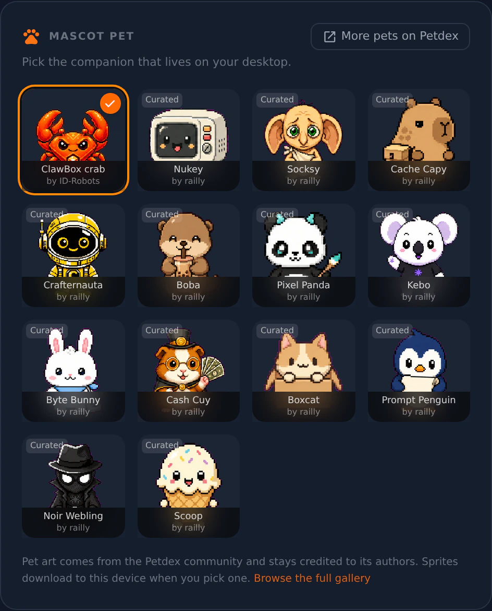

**Settings → Appearance** is where the desktop's look is set, and the page Settings opens on.
Everything here is per-device and survives updates.

## Wallpaper

Four things ship on the box, and you can upload your own picture beside them.

| Wallpaper | Offered on |
|---|---|
| **Lobster Orbital** | OpenClaw and dual — the default there, shown at half strength |
| **ClawBox** | OpenClaw and dual |
| **Hermes** | every edition — the default on Hermes |
| **Deep Space** | every edition |

A ClawBox running Hermes Agent shows no ClawBox artwork: that is another product's
branding. Wallpapers you upload yourself are on every edition.

Beside the picture you get **Fit Mode** (fill, fit or center), **Opacity** and a
**Background Color** the wallpaper is composited over.

**Upload** takes pictures only: another kind of file is refused with a message, and a stored
file that is not a picture shows the default wallpaper instead.

## The mascot

**Show Mascot** puts a companion on the desktop. Click it to open the chat panel; its
menu can send it to sleep or hide it.

## Mascot Pet

**Settings → Appearance → Mascot Pet** chooses the body your companion wears. It is on
every edition.

- The first tile is what your box wears with nothing picked. On a ClawBox running
  OpenClaw that is the **ClawBox crab**, which ships with the box: no download, works
  offline, and it cannot be removed. On a Hermes-edition box the first tile is **None** —
  an egg you can click to hatch a random pet.
- Every other tile is a community pet from the Petdex gallery. Picking one downloads its
  sprites **to your device**; they do not ship with ClawBox. Each tile is credited to
  whoever made it, and **Browse the full gallery** opens the whole collection.
- A pet needs an internet connection the first time you pick it, and works offline
  afterwards.

<Frame caption="Settings → Appearance → Mascot Pet, on a 4.3 box">
  
</Frame>

<Note>
On the Hermes edition, picking a pet writes through Hermes' own pet configuration — the
same store its CLI and dashboard read, so a pet chosen in a terminal moves this picker too.
</Note>

## Language

The desktop is translated into ten languages. Pick yours from the **Language** setting.

## Remote desktop resolution

**Settings → Appearance → Display → Remote desktop resolution** sets the size of the remote
desktop: **1280 × 720** (the default), **1600 × 900** or **1920 × 1080**. Changing it restarts
the remote desktop briefly and closes every app open on it, browser windows included, so you
are asked first. The choice is kept across restarts and updates. It does not apply while the
remote desktop mirrors a physical screen.
