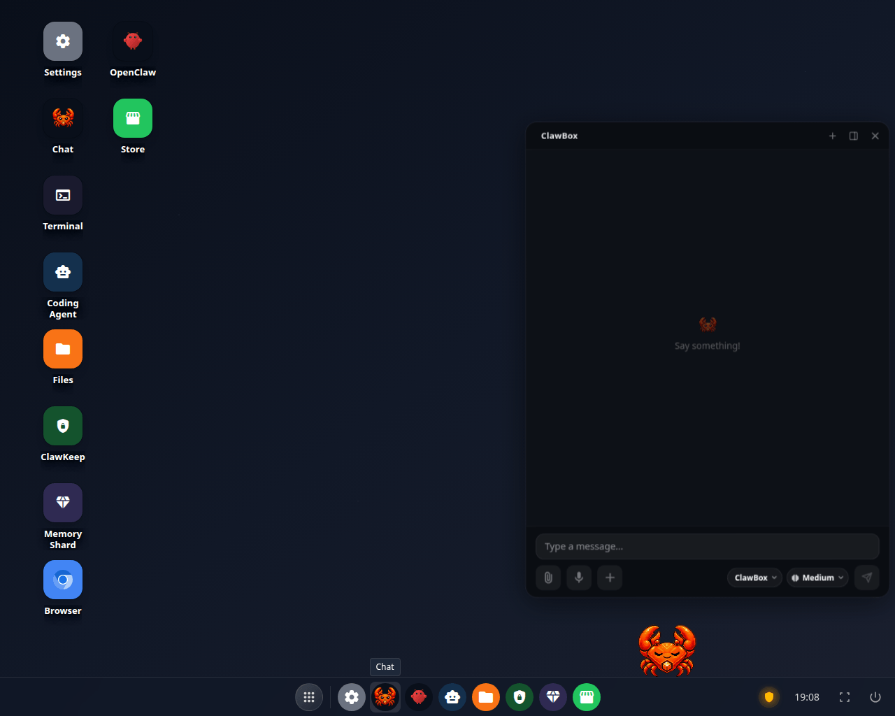
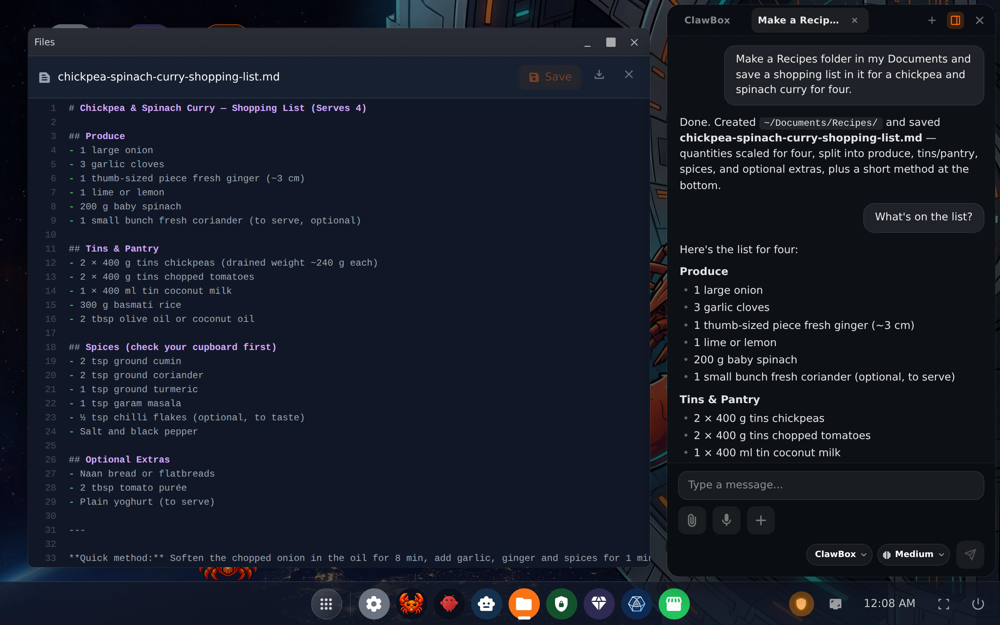
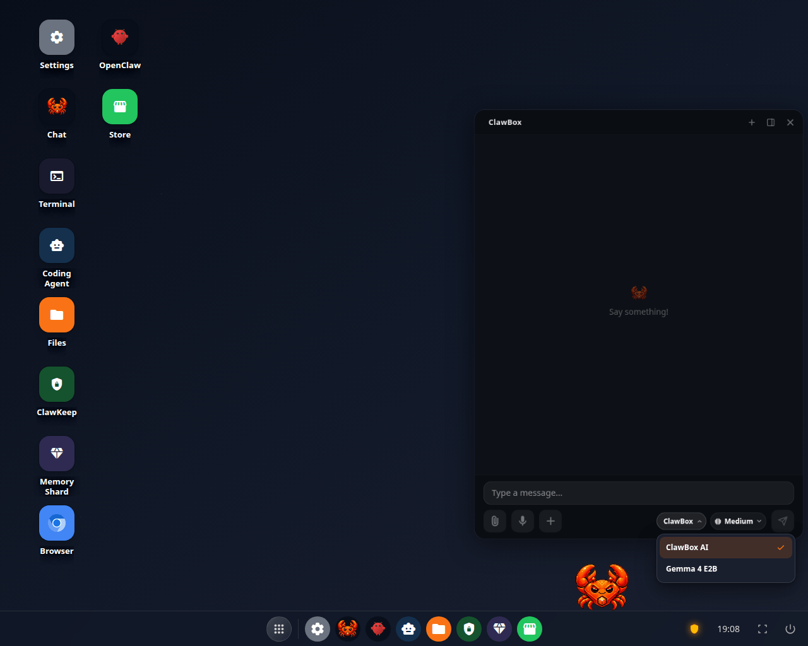
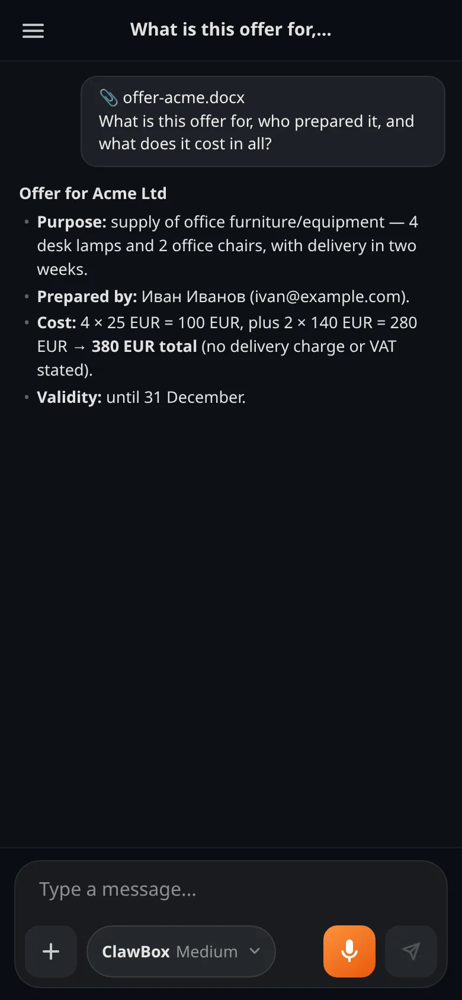
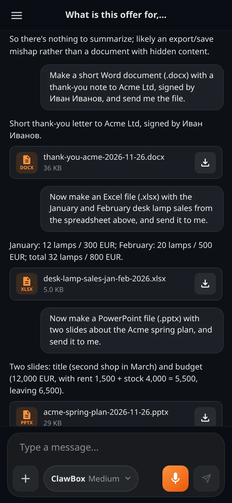
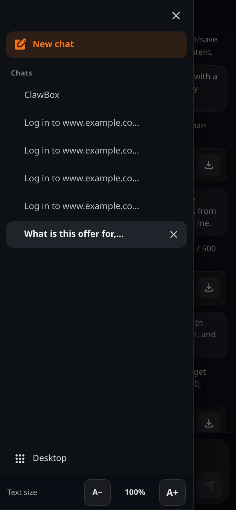

Your ClawBox has two chat surfaces on the desktop, and they talk to the same assistant:

- the **chat panel**, which opens when you click the mascot and docks beside your windows;
- the **Chat** app, a full window from the desktop icon.

Everything on this page is on both [editions](/editions/overview) unless it says otherwise.

<Frame caption="The chat panel on a conversation nobody has said anything in yet">
  
</Frame>

<Frame caption="The chat docked beside Files: the assistant made a folder and a file on the box, and the result is open on the left">
  
</Frame>

On the Hermes edition the chat shows the Hermes icon where these pictures show the crab.

## The pills: provider, model and reasoning

The chat panel carries up to three pills in the row beneath the message box.

| Pill | What it does |
|---|---|
| **Provider** | Which service answers. Picking a different one switches the conversation to it. |
| **Model** | Which of that provider's models. The pill drops the vendor's name because the pill to its left already says it — the dropdown shows the full model name. |
| **Reasoning effort** | How hard the model thinks before answering. The levels on offer are whatever the provider accepts, so this control changes shape: a provider that takes a scale shows it, one that only has thinking on or off shows two states, and one that takes no reasoning level at all does not show the control. |

A change applies to the **running** agent. There is no restart between you and the next
message, and open conversations are not dropped. On OpenClaw, changing the default model in
**Settings → Providers**, installing or switching Local AI, and the local-only switch are
applied live too wherever they can be, so the chat carries on.

<Note>
On **ClawBox AI** there is no model pill — the chat names the provider and there is
nothing to choose. The reasoning control is there and starts at **Medium**.
</Note>

A reasoning change is a **per-conversation** override. It does not rewrite the box's
default, which lives in **Settings → Providers**.

<Frame caption="The provider pill open on a box running ClawBox AI, with the on-device model to switch to">
  
</Frame>

## Slash commands

Type `/` in the composer and a menu appears with the commands your assistant actually
publishes — the built-in ones plus anything your skills and plugins added. Each row shows
the command, its arguments if it takes any, and the agent's own one-line description.
Keep typing to filter; pick a row to insert it.

The list is read from the agent itself, so it is never out of date with what your box can
actually run, and it differs between editions and between boxes with different skills
installed.

## When the assistant needs you

Three kinds of card can appear in the transcript. All three mean the assistant has
stopped and is waiting for you.

<AccordionGroup>
  <Accordion title="A question">
    The assistant asks you to choose. Each option carries its own short description —
    usually the consequence of picking it — and there is a field for an answer of your
    own. One **Send answer** submits the whole card. There is no skip: to decline, leave
    it, and the assistant carries on when its own timer runs out.
  </Accordion>
  <Accordion title="An approval">
    The assistant is asking to do something that needs your permission. **Allow once**,
    **Always allow** or **Deny**. Nothing happens until you answer, and if nobody answers
    in time the window closes and it does not go ahead.
  </Accordion>
  <Accordion title="Email waiting to be sent">
    The assistant wrote a message and wants to send it from your account. You read it
    first and nothing goes out until you approve — this card is what **Ask me before
    sending** in **Settings → Channels → Email** produces, and it is on by default. You can send them
    all, send one, or delete them without sending. See
    [Messaging channels](/guides/messaging-channels#email).
  </Accordion>
</AccordionGroup>

## When a message fails

A failed turn says what actually went wrong: the provider's own reason, not a generic
"the run failed". Two common cases have their own wording:

- **A fallback model answered.** Your first-choice model refused or errored and the next
  model in the chain replied instead. The reply says which model wrote it.
- **An allowance ran out.** On ClawBox AI, the chat says whether it was the weekly chat
  allowance, the **short-term limit (5 hours)** or the memory-indexing allowance, and when
  it frees up — for the weekly allowance also how to add an extra-usage pack. Your usage is
  in **Settings → Providers**.
- **The sign-in is missing or revoked.** When the box has no working sign-in for the
  provider the chat is set to, the chat says so and names the two fixes: connect that provider
  again in **Settings → Providers**, or pick another model in the header. A Claude sign-in that
  needs renewing is marked on the Providers strip too. A ClawBox AI turn that failed on its sign-in
  offers a way to sign in again. See
  [Troubleshooting](/support/troubleshooting#chat-says-the-provider-refused-or-the-sign-in-is-missing).
- **An Anthropic account hit its limit.** With [several Anthropic accounts](/guides/anthropic-accounts)
  on OpenClaw, the next message moves to another account instead of answering with the limit
  message.

## Stopping a reply

**Stop** ends the reply that is being written. Whatever part of the answer had arrived stays,
with a grey **Stopped.** line under it, so a stopped reply is not mistaken for a lost one. On
Hermes the stopped reply is kept after a reload too.

## Long conversations

A conversation keeps growing until it no longer fits what the model can read at once:

- On OpenClaw with ClawBox AI, a long chat is shortened (compacted) automatically, so each
  message does not send more and more of the conversation.
- On the on-device model, a conversation that grows too long offers **a new chat** instead
  of a minutes-long shortening on the box. The card says how much room the model has.

## Voice

**Voice in** — in the **chat panel**, **hold** the microphone button while you speak and let
go to send: the recording is turned into text and sent as a message. A quick click still
starts and stops a recording instead. Holding **F8** while the chat is open does the same, and
**Esc** cancels. The Chat app has no microphone. Recording needs a secure connection, so on a
plain `http://` address the chat points you at this box's Remote Access tunnel instead of
failing silently.

**Voice out** — **Settings → Voice → Spoken replies**, **off by default**. With it on, a
reply gets a player on its bubble: press play, scrub through it, or download the audio.
A question you asked out loud is answered out loud. Where your box answers messaging
channels, a voice note there gets a spoken reply too. Two more switches in **Settings →
Voice**, both off by default:

- **Auto-play every spoken reply** plays the reply to a question you *typed* aloud as well,
  while you are at the chat.
- **Short spoken answers** has a spoken reply say only the main answer, in at most three
  sentences, so it starts sooner. The full reply still appears in the chat.

Spoken replies download compressed — a 15-second reply is about 90 KB. When the cloud voice
does not answer, a reply gives up after about 20 seconds, and a short line under it says the
voice is not answering or could not speak that reply.

<Note>
Speaking on Telegram, WhatsApp and Discord is an OpenClaw-edition feature. On the Hermes
edition the box still answers out loud in the chat; replies on those channels stay in text.
</Note>

## Other things in the composer

- **Attach a picture** or take a photo, and ask about it, or **attach a file**. On Hermes,
  documents reach the assistant even when its model cannot look at pictures.
- **Generate a picture** from a description.
- **Several chats at once**, in the chat panel — tabs across the top, each its own
  conversation. **New session** starts a fresh one in the same tab.
- **Files the assistant produced** appear as cards you can download, with their real name
  and size.

## Word, Excel and PowerPoint files

You can attach a Word, Excel or PowerPoint file in the chat and ask about it. The box takes
the text out of the file and hands it to the assistant, so the answer comes from what the
file says. You can also ask the assistant to make such a file for you. It is for anyone who
uses the chat, on both editions, OpenClaw and Hermes.

### Before you attach a file

- The file is a **.docx** (Word), **.xlsx** (Excel), **.pptx** (PowerPoint), **.odt**
  (OpenDocument text) or **.ods** (OpenDocument spreadsheet). An older .doc, .xls or .ppt
  file is not read: open it on your computer and save it in the newer format first.
- The file is smaller than 10 MB.
- The file has no password.

### Ask about a file

<Steps>
  <Step title="Click Attach file">
    In the chat, click **Attach file** (the paperclip in the row under the message box). On a phone,
    tap **+** first, then **Attach file**. Your device's file picker opens.
  </Step>
  <Step title="Pick the file">
    Pick one file, or several. The name of each file shows above the message box. Click the
    **×** beside a name to take that file off again.
  </Step>
  <Step title="Ask your question and send it">
    Type what you want to know, for example *What does this offer cost in all?*, and send
    it. The assistant answers from the text of the file. A spreadsheet reaches it as one
    table per sheet, so you can ask about a sheet by its name.

    <Frame caption="A Word file and its answer, on a phone held upright">
      
    </Frame>
  </Step>
</Steps>

### Ask the assistant to make a file

<Steps>
  <Step title="Ask for the file in plain words">
    Say what should be in it and which kind of file you want, for example *Make a short Word
    document with a thank-you note to Acme Ltd and send me the file.*
  </Step>
  <Step title="Wait for the card">
    When the file is ready, the answer has a card with the name of the file and a download
    button. Making a file takes longer than a plain answer.
  </Step>
  <Step title="Download the file">
    Click the download button on the card. Your browser saves the file like any other
    download.

    <Frame caption="Three files the assistant made: a Word document, an Excel sheet and a PowerPoint deck">
      
    </Frame>
  </Step>
</Steps>

<Note>
Word and Excel files need nothing extra. The first time you ask for a PowerPoint file, the
assistant first installs a small tool for it, so that answer takes longer and the box has to
be online.
</Note>

### If a file does not work

- **… could not be read, so it was not attached.** The box could not get the text out of
  the file. The same line says why:
  - *The file is password-protected, so its text cannot be read.* Save a copy without a
    password and attach that.
  - *The file is damaged or is not really a Word, Excel, PowerPoint or OpenDocument file.*
    Open it on your computer, save it again as .docx, .xlsx or .pptx, and attach the new copy.
  - *The file unpacks to more than the box reads from one document.* Split it, or save the
    part you need on its own.
- **… could not be attached. Upload failed: Unexpected end of form**: the file is bigger
  than about 10 MB. Make it smaller, for example by saving it without its pictures or by
  splitting it, and attach it again.
- **… is too large to attach. This file is larger than the … upload limit for your account
  on this ClawBox.** You are not the owner, and the owner has set a lower limit for your
  account. Only the owner can change it: see [Users & Staff](/guides/users-and-staff).
- **The assistant says the document is empty.** The file holds only pictures or empty
  pages. The box reads the text of a document, not the pictures in it. To ask about a
  picture, attach the picture itself.
- **The assistant says it cannot open the file, or answers without reading it.** Ask again
  and tell it to read the attached file first. A small on-device model misses files more
  often than a cloud model: pick another one with the **Model** pill on a phone, or the
  provider pill on a computer.

## The chat on a phone held upright

On a phone held upright, the chat fills the screen. Its controls fit into one slim bar at
the top and one message box at the bottom, so the conversation gets the room. It is for
anyone who chats with the box from a phone, on both editions, OpenClaw and Hermes. A phone
held sideways, a tablet and a computer show the chat as before.

### Before you start on a phone

- The box runs ClawBox 4.4 or newer.
- Open the box's address in your phone's browser and sign in. On a phone the box opens
  straight into the chat.

### Find your way around

<Steps>
  <Step title="Hold the phone upright">
    At the top is one slim bar: **Menu** (three lines) on the left and, once the chat has
    messages, the chat's name in the middle. At the bottom is one rounded message box.
    Under the text are **+**, the model pill (for example **ClawBox Medium**), the
    microphone and Send. While the assistant writes, Send turns into **Stop**.
  </Step>
  <Step title="Tap Menu">
    The menu slides in from the left. It has **New chat**, your **Chats**, **Desktop** and
    **Text size**. Tap a chat to open it. The chat you are in has a button on its right:
    **×** closes that chat, and on the main **ClawBox** chat a round arrow starts a new
    session instead. The **×** at the top closes the menu.

    <Frame caption="The menu, slid in from the left">
      
    </Frame>
  </Step>
  <Step title="Change the text size, or go to the desktop">
    In the menu, **A−** and **A+** make the text of the chat smaller or larger. Tap the
    percentage between them to go back to 100%. **Desktop** closes the chat and shows the
    box's desktop. To come back, tap the chat button on the shelf at the bottom.
  </Step>
  <Step title="Tap + to attach a file">
    **Chat options** slides up from the bottom, with **Attach file** and **Create app**. See
    [Word, Excel and PowerPoint files](#word-excel-and-powerpoint-files) for what to do next.
  </Step>
  <Step title="Tap the model pill to change the model">
    The **Model** sheet slides up from the bottom. It has the same choices as the pills on a
    computer: the **Chat provider**, its models, and the **Reasoning effort** (called
    **Thinking** for a Hermes model that can only turn thinking on or off). Picking a provider
    or a model closes the sheet; picking a reasoning level leaves it open.
  </Step>
  <Step title="Hold the microphone to talk">
    Hold it while you speak and let go to send, as described under [Voice](#voice). This
    needs a secure (https) address: see below.
  </Step>
</Steps>

### If the phone looks different

- **The chat has a header with its name and model at the top, and a settings button beside
  the message box, but no Menu.** The phone is held sideways, or the screen is as wide as a
  tablet's. Turn the phone upright, and turn off the browser's desktop-site setting if it is
  on (that setting makes the page wider than 768 pixels). If it still looks the same, the box
  runs a version older than 4.4: see [Updating](/support/updating).
- **The microphone does not record.** On a plain **http://** address the chat shows *Voice
  input works over a secure (HTTPS) address*, and tapping the microphone opens **Use the
  microphone over Remote Access**. Turn on Remote Access in **Settings → Remote Control**
  (the **Open Remote Control** link takes you there), then open the box at its https
  address. You can also send voice messages from Telegram.

## Coding runs in the chat

When the assistant hands work to the [Coding Agent](/whats-new#the-coding-agent-on-a-live-chart),
the run shows as a card in the chat, and the chat that started it hears when it ends. A run
started somewhere else — another browser or device — shows its card in the open chat within
about half a minute, without a reload. A card you hide with **×** stays hidden, in every window
and after a reload; **Show finished coding runs again** brings back only the cards that left on
their own.

## Where the conversation runs

The pills are per-conversation; the box's **default** provider and model are in
**Settings → Providers**, and that is what a new conversation starts on.

When a sign-in has to restart the agent — connecting a subscription, for instance — the
chats you already have open are re-pointed at the new default once the agent answers
again, so a conversation cannot keep running on the old model while the pills name the
new one. If that could not be done, the box tells you rather than leaving it to be
discovered.

## Details

### Word, Excel and PowerPoint files in detail

- **What the box takes out.** From a document: the paragraphs in order, and a table row by
  row with its cells separated by a bar (`|`). From a presentation: the text of each slide
  under its slide number. From a spreadsheet: each sheet as comma separated values under
  the sheet's name, with the values the file stores, so a date is the spreadsheet's date
  number and a formula is its last result.
- **When.** The text is taken out once, when the file arrives, and saved on the box beside
  the file. A file whose text cannot be taken out is refused, and nothing of it stays on the
  box. A document with no text at all (only pictures or empty pages) is not refused: the
  assistant is told that it holds no text.
- **How it reaches the assistant.** On Hermes the text goes into your message, up to
  16 KB per file and 32 KB per message. Past that, the assistant is told where the rest is
  and opens it itself. On OpenClaw the message tells the assistant where the text is, and it
  reads it with its file tools.
- **How much is read.** Up to 1,000,000 characters of text per document. A longer one is
  cut, with a note that the document goes on. A sheet is read up to 20,000 rows or 400,000
  cells. A file that unpacks to more than 160 MB, or one part of it to more than 64 MB, is
  refused as too large.
- **File size.** The chat's own ceiling is 25 MB per file. On ClawBox 4.4 a file over about
  10 MB stops on the way, with *Upload failed: Unexpected end of form*. Users other than the
  owner are also held to the owner's **Largest file per upload or chat attachment** (100 MB
  unless the owner changes it) when it is the lower of the two.
- **Passwords.** A Word, Excel or PowerPoint file with a password, or an OpenDocument file
  saved with encryption, is refused.
- **A dropped folder** that already holds a file named like the saved text (the document's
  name with `.txt` added) is refused, with a message to rename one of the two.
- **Making files.** Word and Excel files are made with tools that come with the box. For a
  PowerPoint file the assistant installs a tool the first time it is asked. On both editions
  the finished file comes back as a download card in the chat.

### The upright phone layout in detail

- The layout is used when the browser window is narrower than 768 pixels and at least as
  tall as it is wide. A wider window, as on most tablets and on a large phone held sideways,
  gets the computer layout. A smaller phone held sideways keeps the earlier phone layout,
  with its own fullscreen choice, which the upright layout ignores.
- The chats in the menu are the same list as the tabs on a computer, shared by every browser
  signed in to the box. A chat that is answering has an orange dot, and one with a reply you
  have not read has a green dot.
- The menu and the two sheets each have an **×** to close them. The phone's Back button
  closes an open menu or sheet before it closes the chat.
- The **Model** sheet holds the same choices as the pills: the provider, that provider's
  models, and the reasoning levels the provider takes.
- On a Hermes box whose assistant cannot draw pictures itself, **Chat options** also has
  **Generate a picture** when the box is signed in to ClawBox AI. Members of staff on an organisation box do not get **Create app**.
