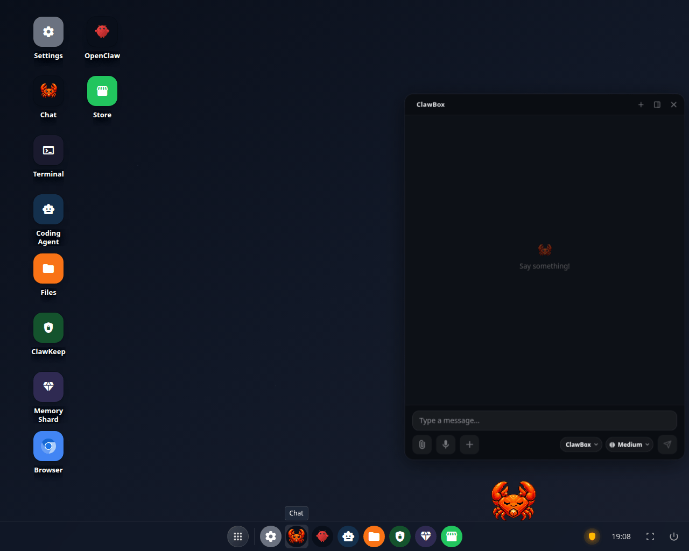
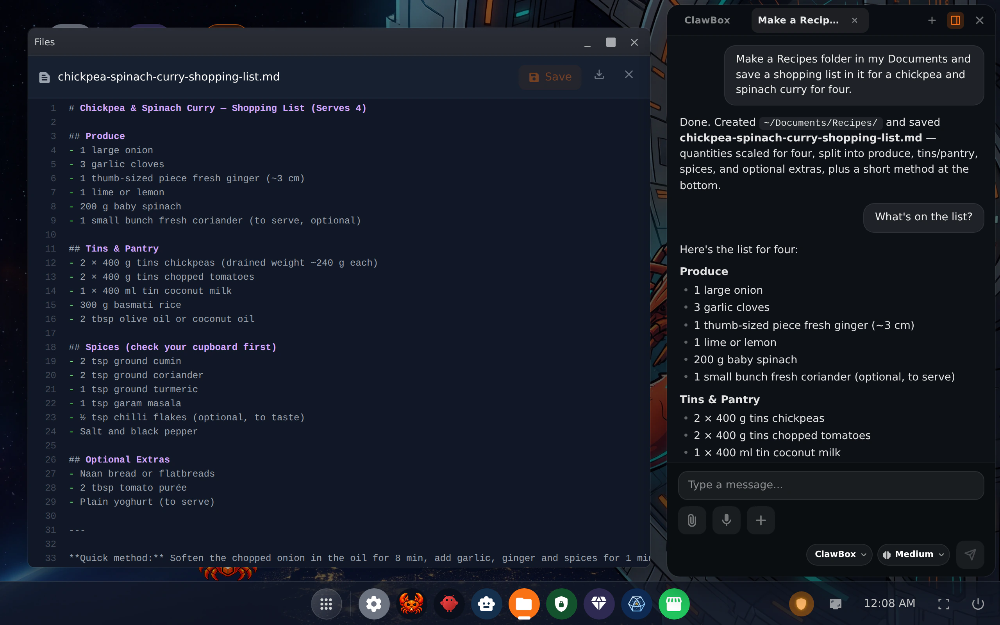
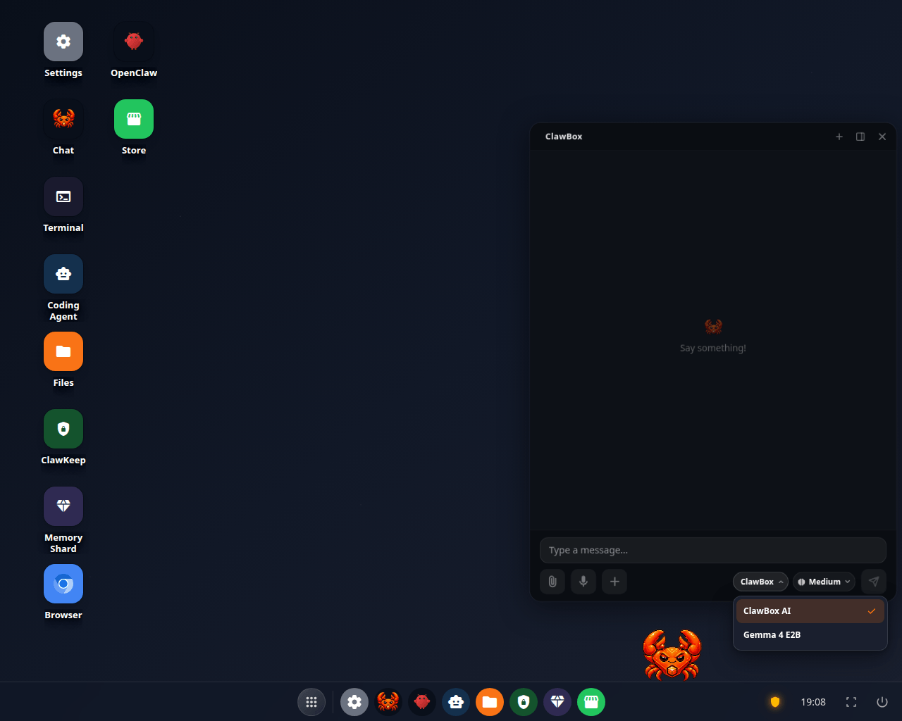

Your ClawBox has two chat surfaces on the desktop, and they talk to the same assistant:

- the **chat panel**, which opens when you click the mascot and docks beside your windows;
- the **Chat** app, a full window from the desktop icon.

Everything on this page is on both [editions](/editions/overview) unless it says otherwise.

<Frame caption="The chat panel on a conversation nobody has said anything in yet">
  
</Frame>

<Frame caption="The chat docked beside Files: the assistant made a folder and a file on the box, and the result is open on the left">
  
</Frame>

On the Hermes edition the chat shows the Hermes icon where these pictures show the crab.

## The pills: provider, model and reasoning

The chat panel carries up to three pills in the row beneath the message box.

| Pill | What it does |
|---|---|
| **Provider** | Which service answers. Picking a different one switches the conversation to it. |
| **Model** | Which of that provider's models. The pill drops the vendor's name because the pill to its left already says it — the dropdown shows the full model name. |
| **Reasoning effort** | How hard the model thinks before answering. The levels on offer are whatever the provider accepts, so this control changes shape: a provider that takes a scale shows it, one that only has thinking on or off shows two states, and one that takes no reasoning level at all does not show the control. |

A change applies to the **running** agent. There is no restart between you and the next
message, and open conversations are not dropped. On OpenClaw, changing the default model in
**Settings → Providers**, installing or switching Local AI, and the local-only switch are
applied live too wherever they can be, so the chat carries on.

<Note>
On **ClawBox AI** there is no model pill — the chat names the provider and there is
nothing to choose. The reasoning control is there and starts at **Medium**.
</Note>

A reasoning change is a **per-conversation** override. It does not rewrite the box's
default, which lives in **Settings → Providers**.

<Frame caption="The provider pill open on a box running ClawBox AI, with the on-device model to switch to">
  
</Frame>

## Slash commands

Type `/` in the composer and a menu appears with the commands your assistant actually
publishes — the built-in ones plus anything your skills and plugins added. Each row shows
the command, its arguments if it takes any, and the agent's own one-line description.
Keep typing to filter; pick a row to insert it.

The list is read from the agent itself, so it is never out of date with what your box can
actually run, and it differs between editions and between boxes with different skills
installed.

## When the assistant needs you

Three kinds of card can appear in the transcript. All three mean the assistant has
stopped and is waiting for you.

<AccordionGroup>
  <Accordion title="A question">
    The assistant asks you to choose. Each option carries its own short description —
    usually the consequence of picking it — and there is a field for an answer of your
    own. One **Send answer** submits the whole card. There is no skip: to decline, leave
    it, and the assistant carries on when its own timer runs out.
  </Accordion>
  <Accordion title="An approval">
    The assistant is asking to do something that needs your permission. **Allow once**,
    **Always allow** or **Deny**. Nothing happens until you answer, and if nobody answers
    in time the window closes and it does not go ahead.
  </Accordion>
  <Accordion title="Email waiting to be sent">
    The assistant wrote a message and wants to send it from your account. You read it
    first and nothing goes out until you approve — this card is what **Ask me before
    sending** in **Settings → Channels → Email** produces, and it is on by default. You can send them
    all, send one, or delete them without sending. See
    [Messaging channels](/guides/messaging-channels#email).
  </Accordion>
</AccordionGroup>

## When a message fails

A failed turn says what actually went wrong: the provider's own reason, not a generic
"the run failed". Two common cases have their own wording:

- **A fallback model answered.** Your first-choice model refused or errored and the next
  model in the chain replied instead. The reply says which model wrote it.
- **An allowance ran out.** On ClawBox AI, the chat says whether it was the weekly chat
  allowance, the **short-term limit (5 hours)** or the memory-indexing allowance, and when
  it frees up — for the weekly allowance also how to add an extra-usage pack. Your usage is
  in **Settings → Providers**.
- **The sign-in is missing or revoked.** When the box has no working sign-in for the
  provider the chat is set to, the chat says so and names the two fixes: connect that provider
  again in **Settings → Providers**, or pick another model in the header. A Claude sign-in that
  needs renewing is marked on the Providers strip too. A ClawBox AI turn that failed on its sign-in
  offers a way to sign in again. See
  [Troubleshooting](/support/troubleshooting#chat-says-the-provider-refused-or-the-sign-in-is-missing).
- **An Anthropic account hit its limit.** With [several Anthropic accounts](/guides/anthropic-accounts)
  on OpenClaw, the next message moves to another account instead of answering with the limit
  message.

## Stopping a reply

**Stop** ends the reply that is being written. Whatever part of the answer had arrived stays,
with a grey **Stopped.** line under it, so a stopped reply is not mistaken for a lost one. On
Hermes the stopped reply is kept after a reload too.

## Long conversations

A conversation keeps growing until it no longer fits what the model can read at once:

- On OpenClaw with ClawBox AI, a long chat is shortened (compacted) automatically, so each
  message does not send more and more of the conversation.
- On the on-device model, a conversation that grows too long offers **a new chat** instead
  of a minutes-long shortening on the box. The card says how much room the model has.

## Voice

**Voice in** — in the **chat panel**, **hold** the microphone button while you speak and let
go to send: the recording is turned into text and sent as a message. A quick click still
starts and stops a recording instead. Holding **F8** while the chat is open does the same, and
**Esc** cancels. The Chat app has no microphone. Recording needs a secure connection, so on a
plain `http://` address the chat points you at this box's Remote Access tunnel instead of
failing silently.

**Voice out** — **Settings → Voice → Spoken replies**, **off by default**. With it on, a
reply gets a player on its bubble: press play, scrub through it, or download the audio.
A question you asked out loud is answered out loud. Where your box answers messaging
channels, a voice note there gets a spoken reply too. Two more switches in **Settings →
Voice**, both off by default:

- **Auto-play every spoken reply** plays the reply to a question you *typed* aloud as well,
  while you are at the chat.
- **Short spoken answers** has a spoken reply say only the main answer, in at most three
  sentences, so it starts sooner. The full reply still appears in the chat.

Spoken replies download compressed — a 15-second reply is about 90 KB. When the cloud voice
does not answer, a reply gives up after about 20 seconds, and a short line under it says the
voice is not answering or could not speak that reply.

<Note>
Speaking on Telegram, WhatsApp and Discord is an OpenClaw-edition feature. On the Hermes
edition the box still answers out loud in the chat; replies on those channels stay in text.
</Note>

## Other things in the composer

- **Attach a picture** or take a photo, and ask about it, or **attach a file**. On Hermes,
  documents reach the assistant even when its model cannot look at pictures.
- **Generate a picture** from a description.
- **Several chats at once**, in the chat panel — tabs across the top, each its own
  conversation. **New session** starts a fresh one in the same tab.
- **Files the assistant produced** appear as cards you can download, with their real name
  and size.

## Coding runs in the chat

When the assistant hands work to the [Coding Agent](/whats-new#the-coding-agent-on-a-live-chart),
the run shows as a card in the chat, and the chat that started it hears when it ends. A run
started somewhere else — another browser or device — shows its card in the open chat within
about half a minute, without a reload. A card you hide with **×** stays hidden, in every window
and after a reload; **Show finished coding runs again** brings back only the cards that left on
their own.

## Where the conversation runs

The pills are per-conversation; the box's **default** provider and model are in
**Settings → Providers**, and that is what a new conversation starts on.

When a sign-in has to restart the agent — connecting a subscription, for instance — the
chats you already have open are re-pointed at the new default once the agent answers
again, so a conversation cannot keep running on the old model while the pills name the
new one. If that could not be done, the box tells you rather than leaving it to be
discovered.
