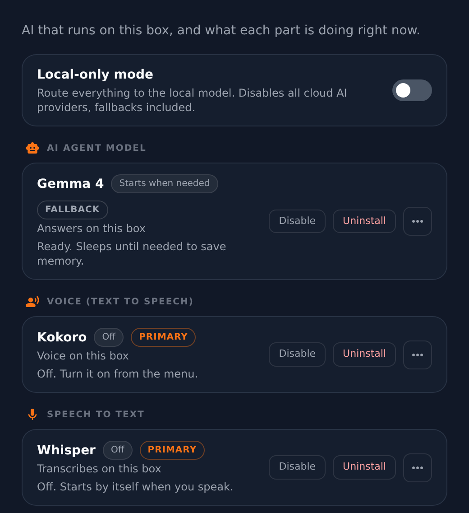

**Settings → Local AI** is the inventory of everything that can run on your ClawBox
without leaving it: the model that answers, the voice it speaks with, the engine that
turns your speech into text, and the model that searches your memory.

## What ships, and what you install

Your box arrives with the local AI runtime and one small model on it. Everything else is
installed when you ask for it.

| Model | On a new box | Size |
|---|---|---|
| **Gemma 4** — the agent model (the provider pickers list it as *Gemma 4 (on-device)*) | installed | included |
| **Kokoro** — the voice | install from this panel | downloaded on request |
| **Whisper** — speech to text | install from this panel, in your choice of size | downloaded on request |
| **Memory search model** — Qwen3-Embedding-0.6B | only if you point [Memory Shard](/guides/memory-shard) at the box rather than the cloud | about 640 MB |
| **Larger memory search model** — Qwen3-Embedding-4B | optional, on a PC with an NVIDIA GPU only ([see below](#memory-search-model-06b-or-4b)) | 2.5 GB or 4.3 GB |

<Note>
This is why updates are quick. Nothing heavy is installed behind your back: an install or
an update sets up the runtime and the small model, and stops there.
</Note>

## The panel

Each row names the model, says what it is doing right now — *Answering right now*,
*Ready. Sleeps until needed to save memory*, *Off. Starts by itself when you speak* — and
carries a menu with the actions that apply to it:

- **Install** / **Uninstall**
- **Enable** / **Disable**, and **Turn on now**
- **Make primary** or **Use as fallback**, for the agent model
- **Manage in Memory Shard**, for the memory-search model

Rows are grouped by job: *AI agent model*, *Voice (text to speech)*, *Speech to text* and
*Other*, which is where the memory-search model sits. Disk and memory in use are shown per
row for a model that is installed and running, so you can see what a model costs before you keep it.

<Frame caption="Settings → Local AI on an OpenClaw-edition box">
  
</Frame>

### Installs run in the background

Every **Install** is accepted at once and runs as a background task with a card in the
desktop's corner, so you can close Settings while it works. An install that cannot run beside
what is already running waits its turn — its row says what it waits for, for example
"Queued — starts after Kokoro" — and starts by itself when that work ends. Model downloads
work the same way. **Cancel** on the corner card removes a task that is still waiting and stops a
model download; an install that is already running as a system step finishes.

<Warning>
**Uninstall** is not offered while Gemma is the primary model — pick another primary
first, and the action appears. Uninstall it when it is not primary, and the next system
update puts it back: it is the one model ClawBox installs on every box.
</Warning>

## How the models behave

- **Gemma 4 (on-device)** runs on the box's own llama.cpp. It wakes on the first request
  and sleeps again afterwards to give the memory back, so the first message after a quiet
  period is slower than the ones that follow.
- **Its reasoning control depends on the edition.** On the **Hermes** edition it is a
  two-state switch — *Thinking off* / *Thinking on* — rather than an effort scale, because
  that is what its backend accepts. On the **OpenClaw** edition it is *Off* / *High*:
  High makes Gemma think before it answers, which takes about twice as long and helps
  most on multi-step questions. It starts at Off in every new chat and on your channels;
  pick High for a hard question, or start one message with `/think high`.
- **On the OpenClaw edition, Gemma works in a lean mode.** A model this small cannot
  follow the full instructions and tool list a cloud model gets, so while Gemma answers it
  gets a short brief — reply in the language you wrote in, do what you ask instead of
  asking back, keep it short — and six tools: read and write files, make a web app, read a
  web page, search the web, and open a page in the browser. While Gemma is your primary
  model, OpenClaw's tool search is off so it sees those tools directly. Switch back to a
  cloud model and it gets the full instructions and every tool again.
- **On the Hermes edition, Gemma works in the same lean mode** — the same short brief and
  the same six tools, shown to it directly, with thinking off unless you switch it on. It
  does not matter whether Gemma is your default model or you picked it in the chat header.
  Hermes needs a model window of at least 64K tokens, so while Hermes is your assistant
  Gemma runs with a 64K window instead of 32K.
- **Turning a local model on makes it available. It does not take over.** Making it your
  default is a separate, explicit choice.
- **Kokoro** starts cold: the first sound can take fifteen seconds or more unless you
  leave it switched on, which keeps it warm. It speaks English only — for other languages
  use the ClawBox AI cloud voice.
- **Whisper** comes in several sizes. Bigger is more accurate and slower, and the box keeps
  using the current one until the new one has finished downloading.

## Memory search model: 0.6B or 4B

Memory search on the box runs **Qwen3-Embedding-0.6B** unless you pick otherwise. On a PC
with an NVIDIA GPU you can pick **Qwen3-Embedding-4B** instead: a larger model from the same
family (Apache-2.0, 2,560-dimensional vectors instead of 1,024) that finds the right passage
more often, and costs more memory and time per file. The choice is in two places — the
**Memory search model** card in this panel, and **Settings → Embedding model → Model on this
box** in [Memory Shard](/guides/memory-shard#where-the-index-is-built) — and both do the same
thing.

| Where | Qwen3-Embedding-0.6B | Qwen3-Embedding-4B |
|---|---|---|
| **ClawBox** (Jetson Orin Nano Super, 8 GB) | yes | no — shown as unavailable |
| **PC with an NVIDIA GPU, 6 GB or more free** | yes | yes — Q8_0 (4.3 GB) with 8 GB free, Q4_K_M (2.5 GB) below that |
| **PC without an NVIDIA GPU** | yes | no — shown as unavailable |

- **On a ClawBox** the 4B does not fit: the Jetson's 8 GB is one pool shared by the system,
  the assistant and every model, and the 4B alone needs about 5 GB while it runs. The card
  says so, and the box refuses it however it is asked — from the panel, from Memory Shard,
  or by the assistant.
- **On a PC without an NVIDIA GPU** it is refused as well. On the processor alone it embeds a
  passage several times slower than the 0.6B: rebuilding an index of a few thousand
  passages takes hours and keeps the processor busy the whole time, and every search waits
  on it. The 0.6B is the model for such a PC.
- **Free** GPU memory is what counts, so a Gemma or Ollama model holding the GPU can make the
  4B unavailable for the moment; stop it and the card offers the 4B again.

The card downloads the model when you pick it — resumable if the connection drops, checked
for disk space first, and verified against the checksum the model's publisher lists before
it is used. **Switching rebuilds the whole index**: vectors from two models cannot be
searched together, so every file is embedded again by the new one (search keeps working on
the old index until then). Switching back to the 0.6B, or to the cloud, works the same way.
A switch never deletes the other model's file; **Remove** on its row takes it off when you
want the disk back.

## Local-only mode

<Note>
Local-only mode is an **OpenClaw and dual** feature. It is built on the OpenClaw gateway's
fallback chain, which the Hermes edition has no equivalent of, so the switch is not offered
there.
</Note>

Once the box's own model is set as **primary** or **fallback**, a **Local-only mode** switch
appears in this panel. It routes everything to the local model and switches every cloud AI
provider off, fallbacks included, and switching it back restores the providers it saved.
Until the local model has one of those two roles the switch is not drawn — there would be
nothing for it to route to.

On OpenClaw, installing or switching Local AI and the local-only switch take effect without
restarting the assistant wherever the change can be applied live. Turning Local AI off
removes only the local model from the fallback list: ClawBox AI, or another cloud model you
chose, stays as the backup, and a local primary is moved back to a cloud model.

Use it when nothing may leave the box. Note that it is about the **AI providers** — see
[Networking](/technical/networking) for what else a ClawBox talks to.

## Local versus the cloud

On a box connected to [ClawBox AI](/guides/clawbox-ai) — on every edition — speech-to-text,
spoken replies and memory indexing default to the cloud your plan covers. The engines on
the box remain the
fallback and remain selectable: pick the box in this panel, or in Memory Shard's settings
for the index, and the box is what it uses. A choice you make here is never overwritten by
a later default.

## External engine

If you already run a bigger model somewhere else — an inference cluster, or a
vLLM, SGLang or llama.cpp server on a computer on your network — the box can use it
as its Local AI instead of the model on the box. Open **Settings → Local AI →
External engine → Set up** and fill in:

| Field | What to enter |
|---|---|
| **Base URL** | The address of the OpenAI-compatible API, usually ending in `/v1` — for example `http://192.0.2.10:8000/v1`. No user name, password or query in it. |
| **API key** | The key the server asks for, or leave it empty if it needs none. It is kept on the box in a file only the box can read and is never shown again; the field says when one is saved. |
| **Model id** | Exactly as the server lists it under `/models` (for example `Qwen/Qwen3-32B`). |
| **Context window** | How many tokens the model takes, as the server runs it. |
| **Max output tokens** | The longest reply to ask for. |
| **The model accepts images** | Tick it for a vision model. |

**Test** asks the server's `GET /models` and writes nothing. It tells you in plain words
when the server cannot be reached, refuses the key, or does not list that model — and in
the last case shows the models it does list, so you can pick one. **Save and use** runs
the same check, then makes the engine the chat's model: the chat header and the provider
list name its model, and you can still switch between it and a cloud model in the chat
header as with the on-device model.

While an external engine is selected, the model on the box is **not started for chat** —
not at boot, not on the first message and not by the assistant restarting — and Ollama, if
it is installed, is stopped too. Speech, speech to text and memory search keep running on
the box as before. **Remove** puts back what Local AI was before you saved: the on-device
model, as the chat's model when it was, or nothing — and Ollama running again when it was.

The address must be the engine's own server. Link-local and cloud-metadata addresses
(169.254.x.x, fe80::…) and 0.0.0.0 are refused, whether typed or behind a name; addresses on
this machine, your network or the internet are fine.

<Note>
**Hermes:** the engine works the same way, with two differences. Hermes needs a context
window of at least 64,000 tokens, so a smaller one is refused. And Hermes decides the
reply length and how it sends images itself, so **Max output tokens** and **The model
accepts images** are not used there. **Local-only mode** is not available while an
external engine is selected on either edition: it promises that nothing leaves the box,
and an external engine is somewhere else.
</Note>

The full prompt and tool set go to an external engine, like a cloud model — the short
prompt the on-device model gets is only for a small model on the box. How the engine is
wired into each assistant is in [AI Providers](/technical/ai-providers#external-ai-engine).

## What the hardware can run

<Note>
**ClawBox** (Jetson Orin Nano Super, 8 GB) runs a small model comfortably and is
best paired with a cloud provider for heavier work. **ClawBox Workstation** (DGX Spark, 128 GB
unified memory) runs models up to roughly 200B parameters locally. See
[Requirements](/hardware/requirements).
</Note>

Bringing your own local model is supported through Ollama and llama.cpp — see
[AI Providers](/technical/ai-providers#local-models-ollama--llamacpp) for how the local
lanes are wired.
