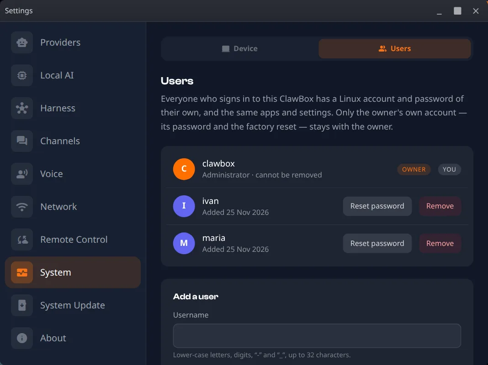
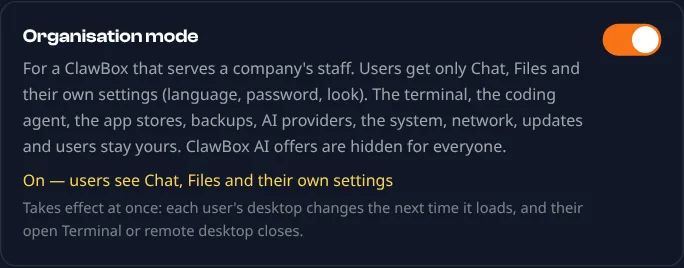
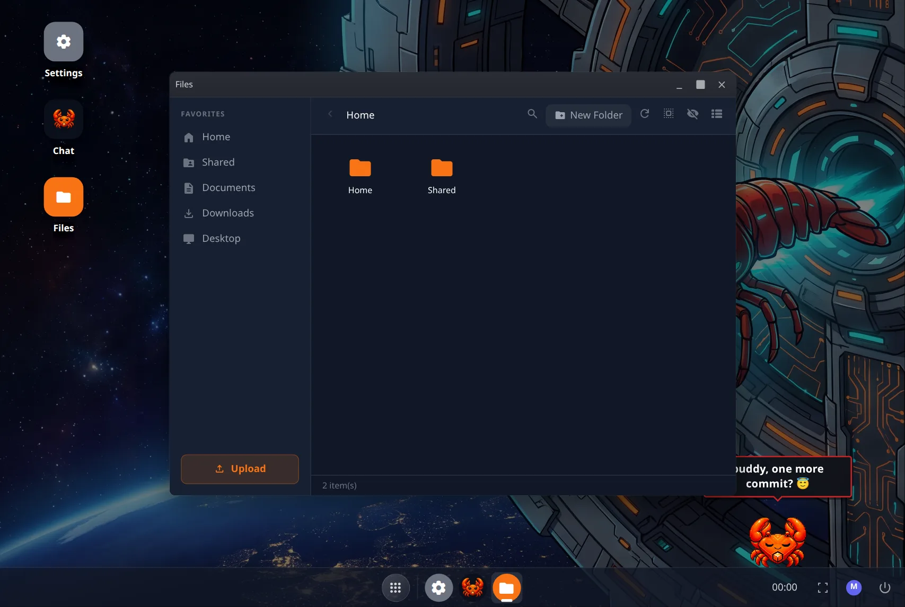
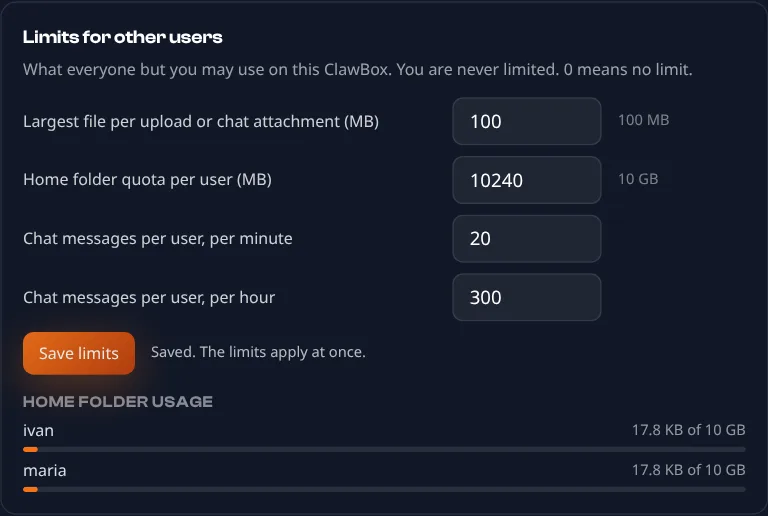
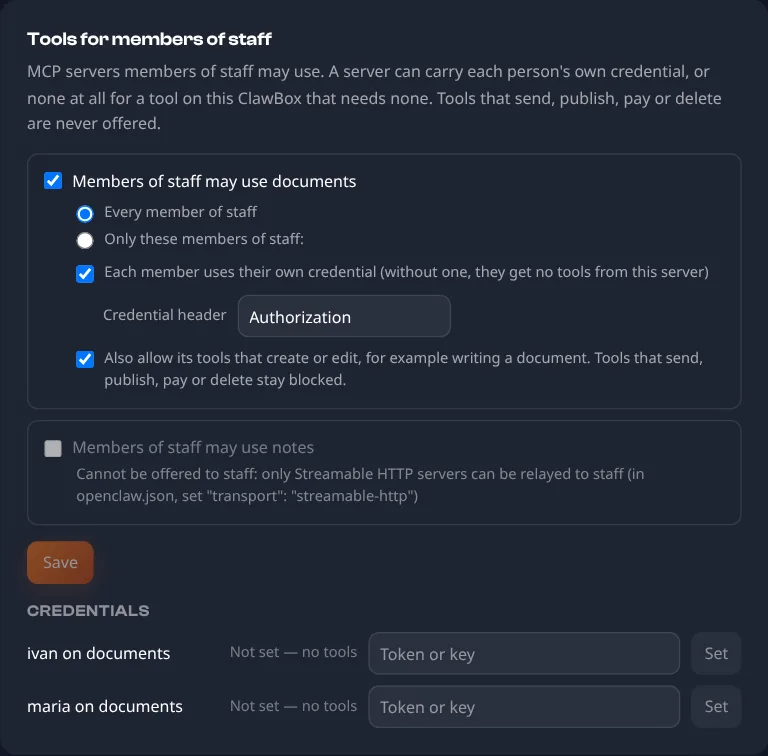

Give other people their own sign in on your ClawBox. Each person gets their own password and
their own chat. Turn on **Organisation mode** when the box serves a company's staff: each
member of staff then gets only a chat, their own files and their own settings, and you keep
everything else. This page is for the owner of the box.

## Before you start

- Sign in as the owner, the account you set the box up with. Only the owner sees the **Users** tab.
- Everything on this page works on both editions, OpenClaw and Hermes, unless a line names one of
  them. None of it needs a ClawBox AI plan.
- Add only people you trust with the box.

## Add a person

<Steps>
  <Step title="Open Settings">
    Open **Settings** from the desktop or the shelf.
  </Step>
  <Step title="Open the Users tab">
    Choose **System** in the list on the left, then the **Users** tab at the top. You see your own
    account, marked **Owner** and **You**. Before you add anyone, the list says **No other users yet.**
  </Step>
  <Step title="Type a username">
    Under **Add a user**, type a name in **Username**, for example `ivan`. Use lower case letters,
    digits, `-` and `_`, up to 32 characters, and start with a letter or `_`.
  </Step>
  <Step title="Type a password">
    Type a password of at least 8 characters in **Choose a password**, and the same again in
    **Repeat the password**.
  </Step>
  <Step title="Create the account">
    Press **Create user**. You see **ivan can now sign in.** and the person appears in the list,
    with **Reset password** and **Remove** beside their name.
  </Step>
  <Step title="Tell the person">
    Give them the username and the password. They open the address of your ClawBox in their
    browser and sign in.
  </Step>
</Steps>

<Frame caption="Settings → System → Users with two people added">
  
</Frame>

## Turn on organisation mode

Leave organisation mode off for family, or for a small team you trust with the whole box. Then
everyone you add gets the same apps as you, apart from updating the box and the assistant's own
consoles. On OpenClaw they also get its console while you share OpenClaw with all users. Turn it on
for a company's staff.

<Steps>
  <Step title="Find the switch">
    In **Settings → System → Users**, scroll to the **Organisation mode** card.
  </Step>
  <Step title="Turn it on">
    Turn the switch on. The line under the text now starts with **On** and says that users see Chat,
    Files and their own settings.
  </Step>
  <Step title="Let your staff reload">
    The change applies at once. Each person's desktop changes the next time it loads. A Terminal or
    remote desktop they still had open closes.
  </Step>
</Steps>

<Frame caption="The Organisation mode card, switched on">
  
</Frame>

Every user other than you is now a **member of staff**. You keep everything else, including the
AI providers and the system settings.

## What a member of staff sees

This is the same on OpenClaw and on Hermes.

<Steps>
  <Step title="Open the box">
    The person opens the address of your ClawBox in their browser.
  </Step>
  <Step title="Sign in">
    They type their name in **Username** and their password in **Password**, then press **Log In**.
    On an organisation box the login page asks for a username instead of listing everyone. You
    leave **Username** empty to sign in as the owner.
  </Step>
  <Step title="Their desktop">
    They see three apps: **Chat**, **Files** and **Settings**. Nothing else.
  </Step>
</Steps>

<Frame caption="A member of staff's desktop, with Files open">
  
</Frame>

- **Chat** runs on an assistant of their own, with its own memory that nobody else reads. It
  answers questions, reads the files they attach and writes files into their own folder. It cannot
  browse the web, send messages, run commands or change the box. If they ask it to search the web,
  it tells them it cannot.
- **Files** shows two folders: **Home**, their own home folder, and **Shared**, one folder that
  every member of staff and you can use. You see it as a folder named **Shared** in your own files.
- **Settings** has only **Appearance** (language, wallpaper and look) and **Account**, where they
  change their own password.
- Their chats use the AI provider you set up for the box.

## Set limits

**Limits for other users** sets what everyone but you may use. You are never limited, and a
ClawBox with only you on it has nobody they apply to. The limits apply to the people you added,
also while organisation mode is off.

<Steps>
  <Step title="Find the limits">
    In **Settings → System → Users**, scroll to **Limits for other users**.
  </Step>
  <Step title="Change a number">
    Type a new number in a box. Type **0** to turn that limit off.
  </Step>
  <Step title="Save">
    Press **Save limits**. You see **Saved. The limits apply at once.**
  </Step>
  <Step title="Check the space used">
    Under **Home folder usage** you see how much each person's home folder holds, for example
    **17.8 KB of 10 GB**. A person who has not opened Files yet shows **Not measured** until they do.
  </Step>
</Steps>

<Frame caption="Limits for other users, at their defaults">
  
</Frame>

| Limit | Default | What happens past it |
| --- | --- | --- |
| Largest file per upload or chat attachment | 100 MB | The upload is refused and the person is told the limit. A chat attachment stays within the chat's own 25 MB limit as well. |
| Home folder quota per user | 10 GB | An upload, or a move from Shared into Home, that would go past it is refused. Deleting files always works. |
| Chat messages per user, per minute | 20 | The message is not sent. |
| Chat messages per user, per hour | 300 | The same, counted over the last hour. |

## Give your staff tools

Your assistant can use MCP servers: services that give it extra tools, such as a document search.
You choose which of them your staff may use. This works on OpenClaw and on Hermes. Before you
start, the server must already be added to your assistant. If the card says **The assistant has no
MCP server yet**, add one first.

<Steps>
  <Step title="Find the card">
    In **Settings → System → Users**, scroll to **Tools for members of staff**. It lists every MCP
    server your assistant has.
  </Step>
  <Step title="Tick a server">
    Tick **Members of staff may use** followed by the server's name. More choices open below it.
  </Step>
  <Step title="Choose who">
    Choose **Every member of staff**, or **Only these members of staff:** and tick the people who
    should have it.
  </Step>
  <Step title="Decide about credentials">
    Leave **Each member uses their own credential** ticked for a service where every person signs
    in as themselves, such as a document search or a Microsoft 365 gateway. Untick it for a tool on
    your ClawBox that needs no sign in, such as a local "create a Word document" tool.
  </Step>
  <Step title="Allow writing, if you want to">
    Tick **Also allow its tools that create or edit** if your staff should be able to write with it,
    for example a document. Without the tick they get read and search tools only.
  </Step>
  <Step title="Save">
    Press **Save**. You see **Saved**. The change applies to each member's assistant straight away.
  </Step>
  <Step title="Set each person's credential">
    If you left **Each member uses their own credential** ticked, a **Credentials** list appears
    with one row per person, for example **ivan on documents**. Type their token or key in **Token or
    key** and press **Set**. The row then shows the credential hidden behind dots, with the last
    four characters of a long one. A person whose row
    says **Not set** gets no tools from that server.
  </Step>
</Steps>

<Frame caption="Tools for members of staff, with one server shared">
  
</Frame>

When a member's assistant uses one of these tools to write a file, the reply shows it as a
download card. Only that member can open it.

## Change a password or remove a person

### Reset a password

<Steps>
  <Step title="Open the form">
    In **Settings → System → Users**, press **Reset password** beside the person. A form opens with
    the title **New password for maria**.
  </Step>
  <Step title="Type the new password">
    Type it in **Choose a password** and again in **Repeat the password**.
  </Step>
  <Step title="Save it">
    Press **Set password**. You see **maria's password was reset.** They are signed out everywhere
    and sign in again with the new password.
  </Step>
</Steps>

### Remove a person

<Steps>
  <Step title="Press Remove">
    Press **Remove** beside the person. The box asks **Remove maria?** and says that their account,
    home folder and files are deleted.
  </Step>
  <Step title="Confirm">
    Press **Remove user**. You see **maria was removed.** They are signed out, and their account,
    their home folder and their files are gone from the box.
  </Step>
</Steps>

## Read the audit log

<Steps>
  <Step title="Open the log">
    In **Settings → System → Users**, scroll to **Audit log**. The newest entries are at the top.
  </Step>
  <Step title="Load more">
    Press **Refresh** to see what happened since you opened the page. Press **Show older entries**
    to go further back.
  </Step>
</Steps>

The log lists who signed in, failed to sign in or signed out, and from which address. It also lists
what was done on the box: users added and removed, passwords reset or changed, organisation mode
and OpenClaw sharing switched on or off, the limits changed, the owner's password changed, updates
started, the assistant's runtime changed, and a factory reset. Only you can read it.

## If it does not work

**A member of staff gets no tool from a server.**
Open **Tools for members of staff** and check three things. The server is ticked and the person
is included. If the server uses a credential, the person's row does not say **Not set**. The server
does not say **Cannot be offered to staff**. If it does, the reason follows: most often the server
is not a Streamable HTTP server (see Details below). Tools also work only while organisation mode is
on. While it is off, the card says **Takes effect while organisation mode is on**.

**An upload is refused.**
Files names the file and says it is larger than the upload limit for their account, or says **Your
home folder is full**. Raise **Largest file per upload or chat attachment** or **Home folder quota
per user** in **Limits for other users**, or ask the person to delete files they no longer need.

**A message gets no answer, or is refused.**
The person has sent more messages than **Limits for other users** allows. On OpenClaw the chat says
**You have reached your chat limit on this ClawBox**, with how many messages it allows and how long
to wait. On Hermes the message can stay without an answer and no time is shown: wait a minute, or
up to an hour if the hourly limit was reached. Then send it again. To allow more, raise **Chat messages per user, per minute** or **per hour**.

## Details

<Note>
Only MCP servers that use the **Streamable HTTP** transport can be offered to staff. On
OpenClaw, an entry that has a `url` but no `transport` counts as SSE: add
`"transport": "streamable-http"` to it in `openclaw.json`. On Hermes, a server that runs a local
command, or uses SSE, cannot be offered: give it a `url`, without a `command`, in `config.yaml`. A
plain-HTTP address works only for a server on the ClawBox itself (`127.0.0.1`, not `localhost`). Anything else
needs HTTPS. A server whose address carries a credential cannot be offered either.
</Note>

**Which tools staff get.** A server you do not tick is never offered to anyone on your staff. The
list shows every MCP server your assistant has, on OpenClaw and on Hermes alike. Members of staff get
read and search tools only, unless you tick **Also allow its tools that create or edit**. Tools that
send, publish, pay, delete or run something stay blocked either way. Your own credentials for the
server are never sent on a member's behalf. **Credential header** names the header that carries a
member's credential; it is `Authorization` unless you change it.

**Files the assistant makes for a member of staff.** When a member's assistant uses a granted tool
to write a file, the reply shows it as a download card. Only that member can open it. Another member
who asks for it by its exact path gets "not found". As the owner, you can still open every file in
the chat media folder, as before.

A file counts as the member's when:

- a tool their own assistant called created it in the assistant's chat media folder during that
  call, and the tool's answer named it (a file that already existed before the call never counts);
  or
- their assistant wrote it into their own assistant folder during their conversation turn.

A file in the shared chat media folder never becomes a member's just because their assistant's
reply mentions it. A path anywhere else on the box, a link that points elsewhere, or a file that
already belongs to another member is never handed out this way.

**Grants are kept per assistant.** If your ClawBox can switch between OpenClaw and Hermes, a grant
you made on one does not carry over to a server with the same name on the other. Granting that
name on the other one moves the grant there, and the credentials set for it are cleared.

**The audit log.** A failed sign in names the account only when it exists on this ClawBox. Nothing
on the box edits an entry. A factory reset empties the log and then records the reset. The log is
kept in the ClawBox data folder, in its current file and one older one, about 10 MB together.
Beyond that, the oldest entries are dropped.

**The quota.** The quota counts each person's own home folder. While organisation mode is on, Files
shows it to them as **Home**. Writes into **Shared** do not count against anyone's quota.

**A member's memory.** On OpenClaw, a member's assistant can also search the folders you indexed
for [Memory Shard](/guides/memory-shard). Check those folders before you turn organisation mode on.

**What else changes.** With organisation mode on, ClawBox AI offers are hidden for everyone, you
included. **Share OpenClaw with all users**, a switch on the Users tab of an OpenClaw ClawBox, does
not reach members of staff. Spoken replies follow your own Voice setting.
