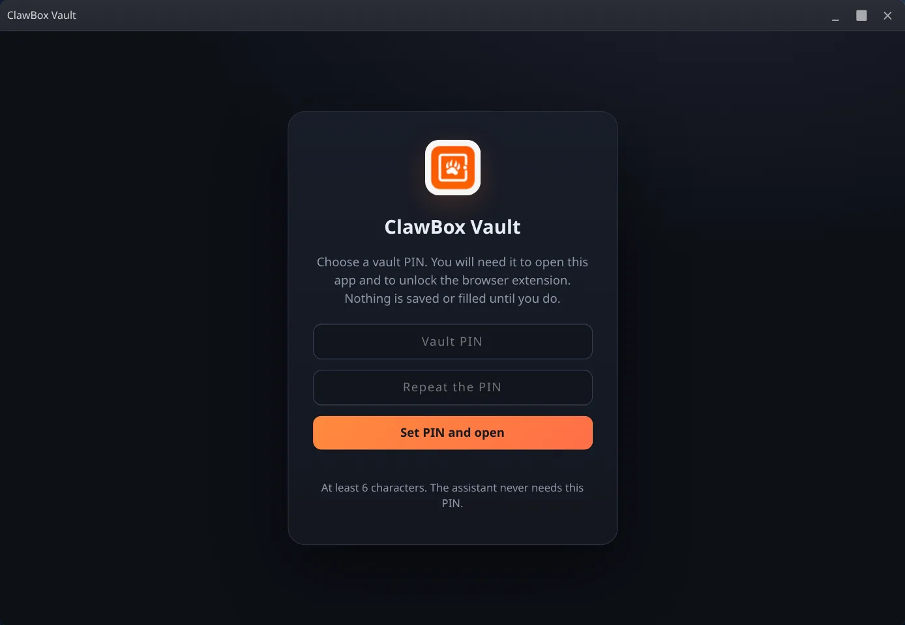
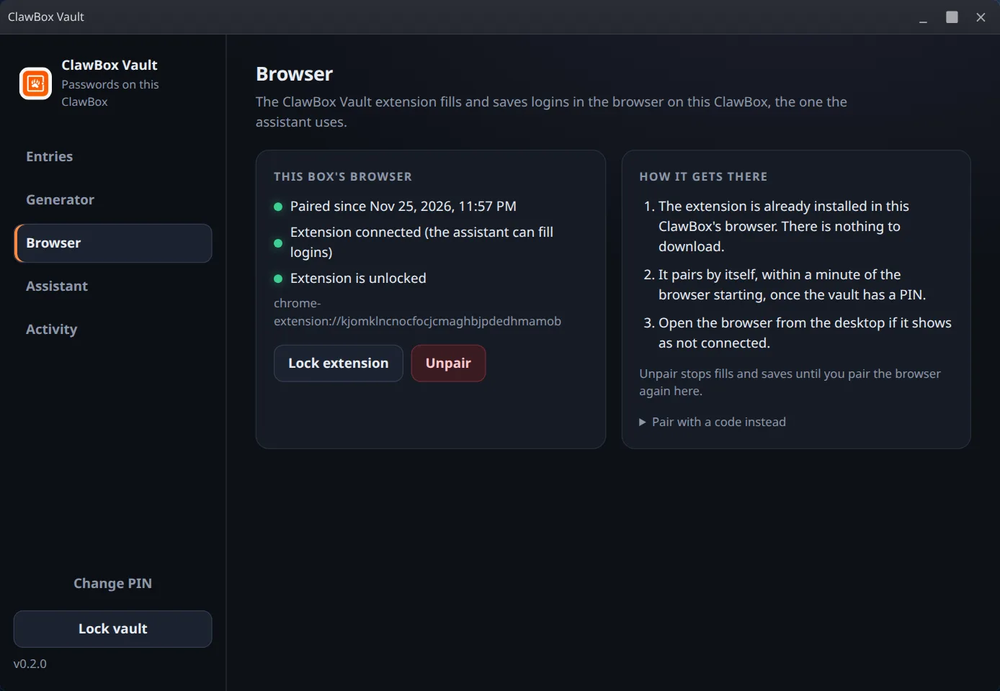
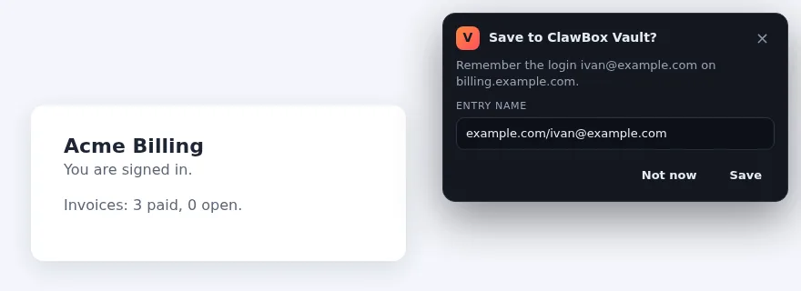
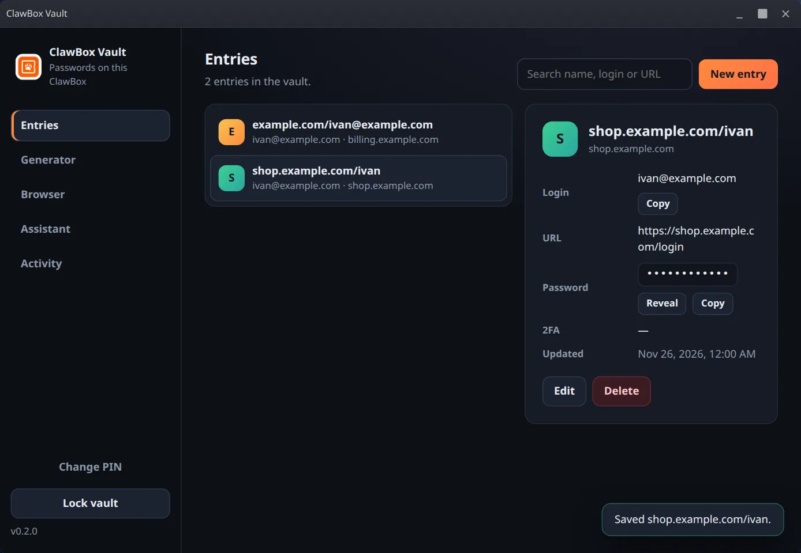
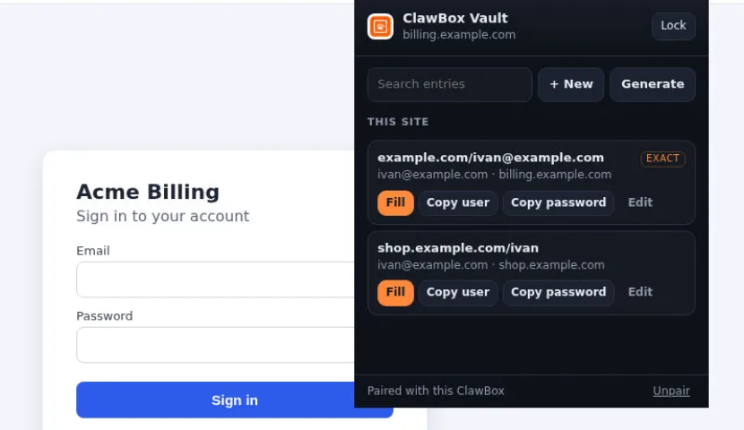
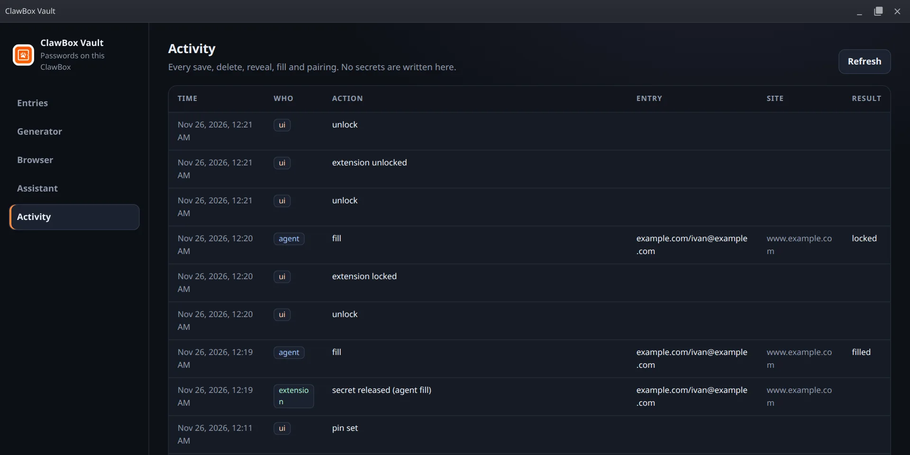

**ClawBox Vault** keeps your website logins on the box itself, encrypted. It fills them
into login pages in the box's own browser, and the assistant can use them to sign in to
a site for you. The assistant never sees a password: the vault types it into the page,
and the assistant only hears whether it worked.

It is for the owner of the box, and it works the same on OpenClaw and on Hermes.

<Note>
ClawBox Vault is the owner's. Other users of the box do not see the app and cannot open it.
</Note>

## Before you start

- Sign in to the box as its owner.
- Nothing else. The vault is already on every box, on OpenClaw and on Hermes. There is
  nothing to install and no plan to buy.

## Set a vault PIN

The vault does nothing until you choose a PIN. Until then it saves no login, fills none,
and the assistant cannot use it.

<Steps>
  <Step title="Open ClawBox Vault">
    On the desktop, click **ClawBox Vault** (the green key). The window asks you to
    choose a vault PIN.
  </Step>
  <Step title="Type a PIN twice">
    Type a PIN of at least 6 characters in **Vault PIN**, and the same PIN again in
    **Repeat the PIN**. Choose one you will remember: you need it each time you open the
    vault.

    <Frame caption="The first time you open ClawBox Vault">
      
    </Frame>
  </Step>
  <Step title="Click Set PIN and open">
    The vault opens on **Entries**. It is empty for now: *No entries yet. Add one, or
    save a login from the browser.*
  </Step>
  <Step title="Check that the browser is connected">
    Click **Browser** on the left. At first it says *Waiting for this box's browser*.
    The page does not update by itself: wait a minute, then click **Browser** again. It
    then says **Extension connected (the assistant can fill logins)**.
    That is all: you do not install anything in the browser.

    <Frame caption="The Browser page once the box's browser is connected">
      
    </Frame>
  </Step>
</Steps>

## Save a login while you sign in

The box has its own browser, the one the assistant uses. You see it in the
**Agent Browser** app. When you sign in to a site there, the vault offers to save the
login.

<Steps>
  <Step title="Open Agent Browser">
    On the desktop, click **Agent Browser**. The window shows the box's own browser. If
    no browser window is there, click **Open Browser** at the top.
  </Step>
  <Step title="Sign in to a site">
    Go to the site's login page and sign in as you always do, with your username and
    password.
  </Step>
  <Step title="Click Save on the vault's bar">
    After you sign in, a dark bar appears at the top right of the page:
    **Save to ClawBox Vault?** It shows your username, the site, and an **Entry name**
    you can change. Click **Save**. The button says **Saved** and the bar closes.

    <Frame caption="The vault's bar after signing in to a made-up site">
      
    </Frame>
  </Step>
  <Step title="Find it in the vault">
    Open **ClawBox Vault**. The login is now listed under **Entries**.
  </Step>
</Steps>

<Tip>
The browser may also ask **Save password?** in its own white panel under the address
bar. That keeps the password in the browser, not in the vault. Click **Not now** there,
and use the vault's bar instead.
</Tip>

## Add a login by hand

<Steps>
  <Step title="Click New entry">
    In **ClawBox Vault**, on the **Entries** page, click **New entry**.
  </Step>
  <Step title="Fill in the login">
    Type a **Name** (for example `shop.example.com/ivan`), your **Login** (username or
    email) and the **URL** of the site's login page. Type the **Password**, or click
    **Generate** to have the vault make a strong one.
  </Step>
  <Step title="Click Save">
    A message says *Saved shop.example.com/ivan.* and the login is in the list.

    <Frame caption="Two saved logins, one of them open">
      
    </Frame>
  </Step>
</Steps>

To read a saved password, click the login in the list, then **Reveal** or **Copy**. The
**Generator** page on the left also makes passwords: **Use in new entry** starts a new
login with the one it made.

## Fill a login yourself

<Steps>
  <Step title="Open the login page">
    In **Agent Browser**, go to the site's login page.
  </Step>
  <Step title="Open the vault in the browser">
    Click the puzzle piece (**Extensions**) at the top right of the browser, then click
    **ClawBox Vault**. A small vault window opens. Under **This site** it lists the logins
    you saved for this site.
  </Step>
  <Step title="Click Fill">
    Click **Fill** next to your login. The vault types your username and password into
    the page, and its window closes.

    <Frame caption="The vault's window in the box's browser, on a site's login page">
      
    </Frame>
  </Step>
  <Step title="Sign in">
    Click the site's own sign in button.
  </Step>
</Steps>

## Let the assistant sign in for you

This works on both editions, OpenClaw and Hermes.

<Steps>
  <Step title="Save the login first">
    The vault must already hold your login for that site. Save it while you sign in, or
    add it by hand (see above).
  </Step>
  <Step title="Ask in the chat">
    Open **Chat** and ask, for example: *Log in to billing.example.com with my saved login
    from ClawBox Vault.* Naming the vault helps the assistant pick the right tool.
  </Step>
  <Step title="Read the answer">
    The assistant opens the site in the box's browser and asks the vault to fill your
    login. The vault types the password into the page itself. The assistant then tells
    you that you are signed in, or why it could not sign in. Open **Agent Browser** if you
    want to see the page.
  </Step>
</Steps>

The assistant can also make a login for a new account. It asks the vault for a strong
password, the vault stores it, and the vault types it into the sign up form. You can read
that password in the app whenever you need it. The assistant never sees it.

### What the assistant can and cannot do

| It can | It cannot |
|---|---|
| See which sites and usernames you saved | See, read or copy any password |
| Ask the vault to fill a login into that site's own page | Fill a login into a different site's page |
| Save a new login, or delete one after asking you | Open the vault app or learn your PIN |

## See what happened

Every fill, save and delete is written down in the vault, with the login and the site.
Passwords are never written there.

<Steps>
  <Step title="Open Activity">
    In **ClawBox Vault**, click **Activity** on the left. The newest lines are at the top.
  </Step>
  <Step title="Read the lines">
    **Who** says who did it: **ui** is you in the vault app, **agent** is the assistant,
    **extension** is the box's browser, and **system** is the vault itself. **Action**,
    **Entry** and **Site** say what happened, to which login, on which site. For a fill by
    the assistant, **Result** says **filled** when it worked, or why it did not, for
    example **locked**.

    <Frame caption="Activity after the assistant signed in twice, once while the browser was locked">
      
    </Frame>
  </Step>
  <Step title="Click Refresh">
    **Refresh** at the top right shows lines added since you opened the page.
  </Step>
</Steps>

## Lock the vault, the browser, or change the PIN

**Lock the vault app**

1. Click **Lock vault** at the bottom left. The window shows *Locked.* and asks for your
   PIN.
2. Type your PIN in **Vault PIN** and click **Unlock** to open it again.

The vault app also locks itself after 15 minutes without use.

**Stop all fills in the browser for a while**

1. In **ClawBox Vault**, click **Browser**.
2. Click **Lock extension**. A message says *Extension locked: no fills until it is
   unlocked.* The assistant cannot sign in anywhere now either, and the vault does not
   offer to save logins.
3. To undo it, click **Unlock extension** on the same page.

**Disconnect the browser from the vault**

1. In **ClawBox Vault**, click **Browser**, then **Unpair**.
2. Confirm with **OK**. The page says *Unpaired. The browser stays out until you pair it
   again.* It stays that way, also after a restart.
3. To connect it again, click **Pair this box's browser**. It connects within a minute.

**Change the PIN**

1. Click **Change PIN** at the bottom left.
2. Type your **Current PIN**, then the new PIN twice.
3. Click **Change PIN**. A message says *PIN changed.*

## Keep a copy of your passwords

ClawKeep does not back up the vault. Your passwords stay on this box and nowhere else. If
you want a copy, you have to make it yourself: see
[Make your own copy](#make-your-own-copy) below.

## If it does not work

<AccordionGroup>
  <Accordion title="No Save to ClawBox Vault? bar after I sign in">
    - **No PIN yet.** The vault offers to save nothing until it has a PIN. Open
      **ClawBox Vault** and choose one.
    - **You signed in somewhere else.** The vault lives only in the box's own browser,
      the one in **Agent Browser**. It is not in the browser on your computer or phone.
    - **The browser is not connected or is locked.** Open **ClawBox Vault**, click
      **Browser**, and check that it says **Extension connected** and
      **Extension is unlocked**.
    - **The page does not start with `https://`.** The vault does not save or fill on
      plain `http://` pages, except pages on the box itself.
    - **The vault already has that login.** It only asks again when the password changed,
      and then the bar says **Update password?**.
  </Accordion>
  <Accordion title="The Browser page does not say Extension connected">
    - *Waiting for this box's browser* or *Extension not connected right now (is the
      browser open?)*: open **Agent Browser**, click **Open Browser** if no browser window
      is there, wait a minute, then click **Browser** again to refresh the page.
    - *Unpaired. The browser stays out until you pair it again.*: click
      **Pair this box's browser** and wait a minute.
    - *Extension is locked*: click **Unlock extension**.
  </Accordion>
  <Accordion title="The assistant says the vault is locked, not set up, or has no login for the site">
    - **Locked**: open **ClawBox Vault**, click **Browser**, click **Unlock extension**,
      then ask again.
    - **Not set up**: the vault has no PIN yet. Open **ClawBox Vault** and choose one,
      then save the login.
    - **No login saved for that site**: save the login first, then ask again. Check that
      the site you named is the one the login belongs to.
    - **The browser is not running**: open **Agent Browser**, then ask again.
  </Accordion>
  <Accordion title="I forgot my vault PIN">
    Your saved logins are not lost. Only the PIN is. You can remove the PIN and choose a
    new one: this takes a few commands in **Terminal**, see
    [Reset a forgotten PIN](#reset-a-forgotten-pin) below. If you would rather not,
    contact ClawBox support (see **Need a hand?** on the [home page](/)).

    A wrong PIN shows *wrong PIN*. After five wrong tries the vault asks you to wait:
    *Too many attempts. Try again in 30 s.* Each further wrong try makes the wait longer.
  </Accordion>
</AccordionGroup>

## Details

### What the assistant gets back

The vault never gives the assistant a password. When it asks the vault to fill a login,
it gets one status back, and it tells you what that means:

| Status | Meaning |
|---|---|
| `filled` | The login was typed into the page. |
| `no_form` | The open page has no login form. |
| `no_tab` | The page is not open in the box's browser. |
| `origin_mismatch` | The form belongs to another site, sits in another site's frame, or the page is plain `http://`. |
| `no_entry` | No saved login matches the site. |
| `locked` | The extension is locked (**Browser → Lock extension**, or **Lock** in the vault's window in the browser). |
| `extension_offline` | The box's browser is closed, or it is unpaired. |
| `timeout` | The browser did not answer within 20 seconds. |
| `error` | The browser could not finish the fill. |

Before the vault has a PIN, every request gets "not set up" instead, and the assistant
tells you to choose a PIN.

### Which pages the vault fills

- Only pages served over `https://`. Plain `http://` is allowed only for pages on the box
  itself (`localhost`).
- Only the site a login belongs to. A login for `example.com` also fits
  `login.example.com`; a login saved for the exact address is offered first.
- Only the page itself, or a frame inside it with exactly the same address as the page. A
  login form inside a frame from any other address is refused.

### Passwords on screen and on the clipboard

- In the app, a password shows only after **Reveal** and hides again after 30 seconds.
- **Copy** puts it on the clipboard, which is cleared after 30 seconds while the vault's
  page stays open.
- **Payment cards are not part of the vault.** It keeps website logins only.

### Where the vault keeps your logins

Everything is in the folder `~/.clawbox-vault` on the box:

- `store`: your logins, each one encrypted.
- `gnupg`: the vault's own key, which decrypts them.
- `state.json`: the PIN (stored as a hash, never in plain text) and the browser's pairing.

The **Files** app, the assistant's file and command tools and the **Coding Agent** are
not allowed into this folder. A factory reset does not remove it.

### Make your own copy

Copy the folders `~/.clawbox-vault/store` and `~/.clawbox-vault/gnupg` to a safe place
yourself, for example over SSH. You need both: the first holds your passwords, and the
second is the key that opens them. Together they are your passwords, so keep that copy as
safe as the passwords themselves.

### Reset a forgotten PIN

This removes the PIN and keeps every saved login. You need the box password (the one you
sign in to the box with).

1. Open **Terminal** on the desktop, or connect to the box over SSH.
2. Stop the vault. Type the box password when you are asked:
   ```bash
   sudo systemctl stop clawbox-vault
   ```
3. Remove the PIN:
   ```bash
   python3 -c "import json,os; p=os.path.expanduser('~/.clawbox-vault/state.json'); d=json.load(open(p)); d.pop('pin',None); json.dump(d,open(p,'w'),indent=2)"
   ```
4. Start the vault again:
   ```bash
   sudo systemctl start clawbox-vault
   ```
5. Open **ClawBox Vault**. It asks you to choose a PIN, as on the first day. Your logins
   are still under **Entries**, and the browser stays connected.
