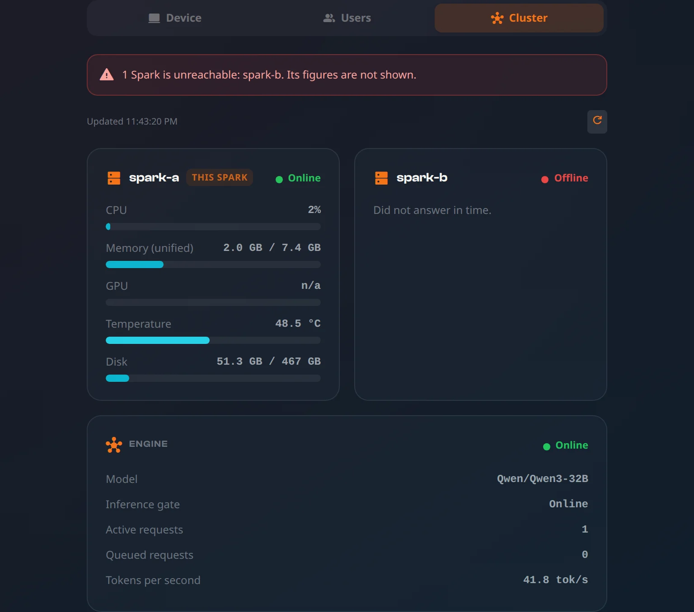

The pro tier: a personal AI supercomputer that runs large models **fully local**,
pre-configured with OpenClaw.

<Card title="Get ClawBox Workstation — €5,499" href="https://clawbox.com" icon="cart-shopping" horizontal>
  NVIDIA DGX Spark, configured and ready to run.
</Card>

## Specifications

| Component | Spec |
|---|---|
| Platform | NVIDIA DGX Spark |
| Superchip | NVIDIA GB10 Grace Blackwell |
| AI performance | Up to 1 petaFLOP (FP4) |
| Memory | 128 GB coherent unified system memory |
| Local model size | Inference up to ~200B params · fine-tune up to ~70B |
| Networking | NVIDIA ConnectX — link two units for ~405B-param models |
| Software stack | NVIDIA AI software stack + OpenClaw pre-installed |
| Power | ~300 W peak |
| Form factor | Compact desktop |

## What it's good for

- **Run large models locally** — keep heavy inference on hardware you own.
- **Prototype, fine-tune, and deploy** reasoning and agentic AI on your desk.
- **Data-science and edge AI** workloads with 128 GB unified memory.
- Everything ClawBox does, with far more local headroom.

## Scaling up

Two ClawBox Workstation units connected over NVIDIA ConnectX can work with models up
to ~405 billion parameters.

<Tip>
To let your ClawBox chat with the model the Workstation runs, follow
[External engine](/guides/local-ai#external-engine) in the Local AI guide.
</Tip>

## Cluster view

A ClawBox Workstation can be made of several Sparks. The Cluster view shows all of them on
one page, together with the AI engine they run, so you can see at a glance that every
Spark is up and how busy the engine is. It is for the owner of the box, on both editions
(OpenClaw and Hermes).

### Before you start

- You need the **owner** account. Other users do not get this page.
- The box must know which other Sparks to read. Until it does, there is no Cluster tab.
  Listing them is a one-time technical step, described under [Details](#details) at the
  end of this page.
- The **Engine** card needs an AI engine set up on the box. See
  [External engine](/guides/local-ai#external-engine).

### Open the Cluster view

<Steps>
  <Step title="Open System">
    Open **Settings** and click **System** in the list on the left. Tabs appear at the top:
    **Device**, **Users** and **Cluster**.
  </Step>
  <Step title="Click Cluster">
    Click **Cluster**. You see one card for each Spark and, under them, the **Engine** card.
    The page reads the figures again by itself every few seconds.
    <Frame caption="Settings → System → Cluster on a test setup: this Spark online, spark-b offline, and the engine's load">
      
    </Frame>
  </Step>
  <Step title="Refresh now, if you want to">
    To read the figures again at once, click the round arrow at the top right of the page.
    When you point at it, it says **Refresh now**. The time after *Updated* changes.
  </Step>
</Steps>

### What the cards show

- **A card for each Spark** shows its name, *Online* or *Offline*, and its **CPU**,
  **Memory (unified)**, **GPU**, **Temperature** and **Disk**. The Spark you are signed in to
  is marked *This Spark*. A figure a Spark does not report shows *n/a*, never a zero.
- **Memory (unified)** is everything running on that Spark, not only its part of the
  model. A Spark's GPU has no memory of its own and shares this memory.
- **The Engine card** shows the **Model**, whether the engine answers (**Inference gate**
  *Online*), and how busy it is: **Active requests**, **Queued requests** and **Tokens per
  second**.
- **A red banner** at the top names any Spark that cannot be reached, for example *1 Spark
  is unreachable: spark-b. Its figures are not shown.*

### If it does not work

- **A Spark shows Offline.** Its card says why:
  - *Cannot be reached on the cluster network.* Check that the Spark is switched on and
    connected to the cluster network, and that its name is listed correctly.
  - *Did not answer in time.* The Spark may be starting up or very busy, or the network is
    slow. Wait a minute, then click **Refresh now**.
  - *Refused this box's SSH key.* That Spark does not let this box sign in. The account
    that runs ClawBox needs sign-in without a password on that Spark (see [Details](#details)).
  - *Its SSH host key is not trusted by this box.* This box has not yet accepted that
    Spark's identity. Connect to it once by hand, as described under [Details](#details).
- **The engine's load shows n/a** and the card says *The engine publishes no metrics this
  page can read, so its load shows n/a.* The engine itself works, and so does the chat; the
  engine just does not report its load in a way this page can read.
- **The Engine card says** *No AI engine is set up.* Set one up under **Settings → Local
  AI → External engine** ([how](/guides/local-ai#external-engine)).
- **There is no Cluster tab**, only **Device** and **Users**. The box does not know of any
  other Spark yet, or you are not signed in as the owner. List the other Sparks as
  described under [Details](#details).

## ClawBox vs Workstation

| Spec | ClawBox | ClawBox Workstation |
|---|---|---|
| Platform | Jetson Orin Nano | DGX Spark (GB10) |
| Memory | 8 GB | 128 GB unified |
| Best for | Always-on assistant | Large local models |
| Power | 7–15 W | ~300 W |
| Price | €749 | €5,499 |

<Card title="Set it up" href="/setup/first-boot" icon="power-off" horizontal>
  Power on and run the guided wizard.
</Card>

## Details

### Listing the other Sparks

The view reads the other Sparks over SSH with a read-only script: nothing is installed on them and
nothing is written there. It connects to the names you list exactly as `ssh` on this box would, so an
alias or jump host in the SSH configuration is followed. Keeping those connections on your own network is
part of setting up the peers. The tab appears once the box knows which Sparks to read. Add them to the
`.env` file in the ClawBox folder and restart ClawBox:

```bash
CLAWBOX_CLUSTER_PEERS="spark-b spark-c spark-d"
```

List the other Sparks, not the one you are on (up to eight are read). Passwordless access is not
enough on its own: the connection never asks a question, so a peer whose host key the ClawBox account
has not yet trusted shows as offline ("Its SSH host key is not trusted by this box."). Before you restart ClawBox, sign in as
the account that runs ClawBox and connect to each peer once (`ssh spark-b true`), checking the host key
fingerprint it shows before you accept it. Then confirm that `ssh -o BatchMode=yes spark-b true`
finishes without a prompt.

On a Workstation the tab is shown as soon as peers are listed. `CLAWBOX_CLUSTER_VIEW=off` in the same
file hides it, and `CLAWBOX_CLUSTER_VIEW=on` shows it on a box that is not a Workstation as well.

### The figures

The System page's own figures are the Spark you are signed in to, which can mislead on a cluster: its GPU
can read 0% because the engine spans every Spark. Each card's memory figure is the Spark's whole system
memory in use (everything running on it, not only its share of the model). A GB10's GPU has no memory of
its own and shares that system memory, so the cluster view labels it unified memory.

### The engine

The Engine card shows the engine set up under **Settings → Local AI → External engine**. To show
another one, put its address in the same `.env` file, for example
`CLAWBOX_CLUSTER_ENGINE_URL=http://192.0.2.10:8000/v1`. The box only contacts an engine on this machine
or your local network; for any other address the card says the gate is outside the local network and
was not contacted. The engine's load comes from its own `/metrics` page (vLLM, SGLang and llama.cpp all
have one); when the engine has none, the figures show n/a.
