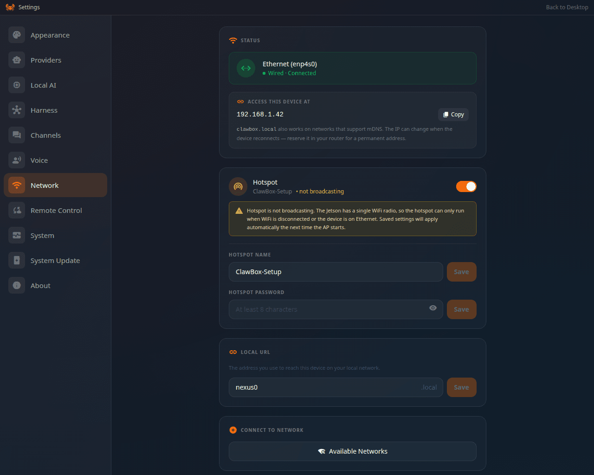

ClawBox needs an internet connection to reach your AI provider and chat channels.

<Frame caption="Settings → Network: what the box is connected to, and the address to reach it at">
  
</Frame>

## Ethernet (recommended for setup)

Plug an Ethernet cable into the ClawBox before powering on. It connects automatically —
no configuration needed — and the wizard's first screen offers **Continue with Ethernet**.
This is the most reliable path for first-time setup.

## Wi-Fi during first setup

The wizard's first step, **WiFi**, lists the networks the box can see. Pick yours and enter
its password. The box then leaves the `ClawBox-Setup` hotspot to join your network, so rejoin
your own Wi-Fi on your phone or laptop and open the box at its new address to continue. See
[First Boot](/setup/first-boot).

## Changing networks later

<Steps>
  <Step title="Open Settings → Network">
    The top of the page shows the connection (**Ethernet** or the Wi-Fi network) and the address
    the box can be reached at, with a copy button.
  </Step>
  <Step title="Pick a network">
    Under **Connect to a network below**, choose the Wi-Fi network and enter its password.
  </Step>
  <Step title="Confirm">
    Wait for the connection to confirm. The box keeps the network saved for the next boot.
  </Step>
</Steps>

<Warning>
The box has a single Wi-Fi radio. Connecting it to a Wi-Fi network stops the `ClawBox-Setup`
hotspot, and switching the hotspot on disconnects it from Wi-Fi. Make sure you can reach the
device on the new network before you connect — or use Ethernet while you change things.
</Warning>

Double-check the Wi-Fi password if the connection fails — a wrong password is the most
common cause, and the page says when authentication fails.

## The hotspot

**Settings → Network → Hotspot** names the setup hotspot, sets its password and switches it on
or off. Changes apply the next time the hotspot starts. A hotspot you switched off stays off,
also when Ethernet is unplugged before setup has finished.

If the box loses its network, it keeps trying the saved Wi-Fi network while it brings the
hotspot back, and its recovery is bounded so it is never left with neither Wi-Fi nor a hotspot.
Join `ClawBox-Setup` and browse to `http://10.42.0.1` (or `http://10.43.0.1`) to reach it
that way.

## Finding the device IP

If `clawbox.local` won't resolve on your network, locate the ClawBox in your router's
connected-devices list to get its IP address, then browse to `http://<device-ip>`. Settings →
Network shows the address too, once you are in. See
[Networking](/technical/networking#why-clawboxlocal-sometimes-fails--and-what-to-do).

## Still offline?

See [Troubleshooting → Wi-Fi and network](/support/troubleshooting#wi-fi-and-network) or
[contact support](mailto:yanko@idrobots.com).
