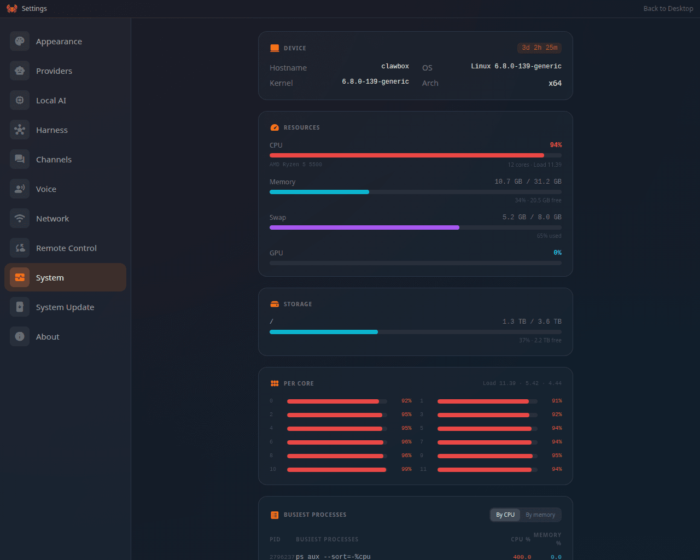

Find your symptom below. Each one names the **likely cause**, then the steps to fix it — first
what you can do on the ClawBox screen, then commands for SSH or the **Terminal** app on the
desktop. Run them in order and stop as soon as the problem is gone.

Commands marked **over SSH** are typed after connecting with `ssh clawbox@YOUR_BOX_IP` (your
system password from setup). The Terminal app on the desktop runs the same commands, as long as
the desktop still loads.

<Frame caption="Settings → System → Device, the first place to look when the box is behaving oddly">
  
</Frame>

## Fast triage

| Symptom | Go to |
|---|---|
| The page does not load at all | [I can't reach the ClawBox](#i-cant-reach-the-clawbox) |
| The login page refuses the password | [The browser rejects my password](#the-browser-rejects-my-password-but-ssh-accepts-it) · [Forgot the password](/support/password-recovery) |
| An update hangs, fails, or the box came back on the old version | [An update is stuck, failed or rolled back](#an-update-is-stuck-failed-or-rolled-back) |
| The update finished but things act strangely | [Update finished but the box misbehaves](#update-finished-but-the-box-misbehaves) |
| The chat or Telegram gets no answer | [The assistant is not answering](#the-assistant-is-not-answering) |
| Something only happens on OpenClaw, or only on Hermes | [OpenClaw and Hermes problems](#openclaw-and-hermes-problems) |
| The chat shows a provider, sign-in or limit error | [Chat says the provider refused](#chat-says-the-provider-refused-or-the-sign-in-is-missing) |
| The box fell off your network, or Wi-Fi will not connect | [Wi-Fi and network](#wi-fi-and-network) |
| The remote address does not work | [Remote access](#remote-access) |
| A backup or restore fails | [ClawKeep backup and restore](#clawkeep-backup-and-restore) |
| Telegram, Discord, WhatsApp or email went quiet | [Telegram and other channels](#telegram-and-other-channels) |
| "Not enough free disk", or the disk meter is full | [The disk is full](#the-disk-is-full) |

## I can't reach the ClawBox

**Likely cause:** the wrong address (`clawbox.local` not resolving, or the gateway's port typed
by hand), the box on a different network than you, or its web server stopped.

<AccordionGroup>
  <Accordion title="Use the plain IP — not clawbox.local, not :18789">
    Two very common mistakes:

    1. **`clawbox.local` often fails on Windows**, behind a VPN, and on routers that block mDNS between Wi-Fi and wired devices. Use the raw IP address instead.
    2. **Don't add `:18789`** to the address. That port is the internal AI gateway (on OpenClaw boxes); it does not accept your password, and on a Hermes box nothing listens there at all. The ClawBox screen is served at **`http://YOUR_BOX_IP`** (port 80, nothing after the IP).
  </Accordion>
  <Accordion title="Find the box's IP address">
    - **Router method (easiest):** open your router's connected-devices list and look for `clawbox`.
    - **If SSH by name works** (`ssh clawbox@clawbox.local` connects in a terminal even when the browser fails): run `hostname -I` over SSH — the first address is the box's LAN IP.

    Bookmark the IP once found. It can change after a reboot on dynamic leases — reserve it in your router settings for a permanent address.
  </Accordion>
  <Accordion title="Nothing loads at the IP either">
    Over SSH, check and restart the web server:

    ```bash
    systemctl is-active clawbox-setup
    sudo systemctl restart clawbox-setup
    ```

    Wait ~30 seconds and reload `http://YOUR_BOX_IP`. If SSH doesn't work either, power-cycle the box and wait 2 minutes. Still nothing: [Recovery](/support/recovery).
  </Accordion>
  <Accordion title="The box went back to the ClawBox-Setup hotspot">
    See [Wi-Fi and network](#wi-fi-and-network) below.
  </Accordion>
</AccordionGroup>

## The browser rejects my password (but SSH accepts it)

There is **no separate admin password** — the browser login uses the same system password as SSH. When SSH accepts it but the browser says *Incorrect password*, work down this ladder. (If *neither* accepts it — the password is forgotten, not mistyped — that's a different page: [Forgot the Password](/support/password-recovery).)

<Steps>
  <Step title="Confirm you're on the right page">
    The login must be at `http://YOUR_BOX_IP` (port 80). The `:18789` page is the gateway — it will never accept your system password. On a box with several users, pick your own name on the sign-in page; the owner's password does not open another user's desktop.
  </Step>
  <Step title="Rule out browser autofill">
    Open a **private/incognito window** (`Ctrl+Shift+N`), type the URL and the password **by hand** — don't let the browser autofill. A stale saved password is the most common cause. If this works, delete the saved password for the box's IP in your browser settings.
  </Step>
  <Step title="Test the password exactly as the web app checks it (over SSH)">
    ```bash
    read -rsp 'Box password: ' PW; echo; printf '%s\0' "$PW" | /usr/sbin/unix_chkpwd clawbox nonull; echo "RESULT exit=$?"; unset PW
    ```

    - `RESULT exit=0` → the password itself is fine; continue to the next step.
    - Any other number → the password check itself fails. If your password contains accented or non-ASCII characters, the browser may encode them differently than the terminal did when the password was set — reset to a simple ASCII password with `sudo passwd clawbox` and retry.
  </Step>
  <Step title="Test the login API directly (bypasses the browser)">
    ```bash
    read -rsp 'Box password: ' PW; echo; curl -sS -X POST http://localhost/login-api -H 'Content-Type: application/json' -d "{\"password\":\"$PW\",\"duration\":1200}"; echo; unset PW
    ```

    - `{"success":true}` → the server accepts it; the problem is browser-side (step 2).
    - `{"error":"Incorrect password"}` → continue to the next step.
    - A lockout message → too many attempts; wait 5 minutes and retry.
  </Step>
  <Step title="Check the password helper's permissions">
    ```bash
    ls -l /usr/sbin/unix_chkpwd /etc/shadow
    ```

    Expected (note the `s` and the `shadow` group):

    ```
    -rwxr-sr-x 1 root shadow ... /usr/sbin/unix_chkpwd
    -rw-r----- 1 root shadow ... /etc/shadow
    ```

    If `unix_chkpwd` shows `-rwxr-xr-x` (no `s`) or a different group:

    ```bash
    sudo chgrp shadow /usr/sbin/unix_chkpwd
    sudo chmod 2755 /usr/sbin/unix_chkpwd
    sudo systemctl restart clawbox-setup
    ```
  </Step>
  <Step title="Set a fresh password (10 seconds, no data loss)">
    ```bash
    sudo passwd clawbox
    ```

    Sets a brand-new password that both SSH and the browser use immediately. Use simple ASCII characters, then retest in a private window.
  </Step>
  <Step title="Rebuild the web app (a half-finished update can serve a stale build)">
    Run the safe reinstall — [Recovery, option C](/support/recovery#c--safe-reinstall-1015-minutes-no-data-loss) (10–15 minutes; settings and keys are kept) — then retest in a private window. If even a fresh password on a fresh build fails, contact support with the outputs of steps 3–5.
  </Step>
</Steps>

<Note>
A desktop whose sign-in expired, or was signed out elsewhere, goes to the sign-in page by itself.
Sign in again; nothing you had open on the box was lost.
</Note>

## An update is stuck, failed or rolled back

How an update runs, and the buttons on its screen, are on [Updating ClawBox](/support/updating).

<AccordionGroup>
  <Accordion title="'Agents are working right now' — the update will not start">
    **Cause:** a coding run or an assistant task is still working, and the update would stop it
    mid-task.

    **Fix:** press **Cancel**, let the work finish (the Coding Agent shows its runs), then press
    **Update** again — or press **Update anyway** and start the stopped runs again afterwards. See
    [When agents are running](/support/updating#when-agents-are-running).
  </Accordion>
  <Accordion title="The screen sits on 'Restarting — not answering yet'">
    **Cause:** the update is restarting the box's services, or rebooting it for a kernel or system
    library. Both are normal and take a few minutes; the page reconnects on its own.

    **Fix:**

    1. Wait 10 minutes and don't power the box off. The screen says when it is taking longer than
       usual.
    2. If the box still does not come back, power-cycle it. The desktop unlocks by itself on the
       next start, and System Update shows where the update stopped.
    3. Over SSH, see what the last update steps printed:

       ```bash
       journalctl -u 'clawbox-root-update@*' --since "2 hours ago" --no-pager | tail -n 80
       journalctl -u clawbox-setup --since "2 hours ago" --no-pager | tail -n 80
       ```
  </Accordion>
  <Accordion title="'Update failed', with a step in red">
    **Cause:** one step could not complete — most often the internet dropped mid-download, the
    disk was too full, or a service did not come back. The box's code is put back to match the
    build it is still running, so it keeps working on the old version.

    **Fix:**

    1. Open **Update log** on the update screen and read the last lines of the red step.
    2. If the box restarted or lost power mid-update, press **Resume update** — it continues from
       the step that was running. Otherwise press **Dismiss**, then **Update** again.
    3. If it stops at the same step twice, check the internet (`ping -c 3 1.1.1.1` over SSH) and
       the disk ([The disk is full](#the-disk-is-full)), then try **Advanced options → Force full
       update**.
    4. Still failing: send support the journal lines from the accordion above.
  </Accordion>
  <Accordion title="'Not enough free disk' to move OpenClaw's data">
    **Cause (OpenClaw):** the update has to move the assistant's data to OpenClaw's newer format
    and needs free space for it. It stops **before** it changes OpenClaw and says how much it needs
    and how much is free.

    **Fix:** free the space it names — see [The disk is full](#the-disk-is-full) — then run the
    update again. The OpenClaw app says **OpenClaw's agent data needs attention** until it has run.
  </Accordion>
  <Accordion title="The update refuses because it would install an older OpenClaw or Hermes">
    **Cause:** the branch the box follows was switched (for example from beta back to `main`) to one
    that pins an older agent than the one that wrote the box's data. OpenClaw's data move is
    one-way, so that update is refused before anything changes.

    **Fix:** open **System Update → Advanced options**, switch the **Beta channel** or **Branch
    override** back to what it was, and update from there; wait for the release channel to catch
    up rather than going back. Only if you must run the older release, choose **Back up and update
    anyway** — see [Going back to an older release](/technical/update-system#going-back-to-an-older-release).
  </Accordion>
  <Accordion title="System Update says 'You're up to date', but you expected a newer version">
    **Cause:** the box offers only what is on the branch it follows. A release reaches `main`, the
    release channel, after it has been validated on beta; a box with a branch override follows that
    branch only. The answer is also cached for up to 30 minutes.

    **Fix:**

    1. Press **Check for updates** — it asks the update server again instead of using the cache.
    2. Open **Advanced options** and read the line under it: *Updates follow `main`, the release
       channel* (or the branch it names). Turn **Beta channel** on only if you want pre-release
       builds.
    3. **Couldn't reach the update server** means the box cannot reach GitHub — check its internet
       ([Wi-Fi and network](#wi-fi-and-network)).
  </Accordion>
  <Accordion title="Code edited by hand on the box disappeared">
    **Cause:** an update hard-syncs the ClawBox checkout (`/home/clawbox/clawbox`) to the branch it
    follows, so local code edits there are discarded. Your settings, keys, chats and files live
    outside the checkout and are kept. Keep your own code in your home folder or a Coding Agent
    project instead.
  </Accordion>
</AccordionGroup>

If the update screen itself will not open or run, use the **recovery updater** on
[Updating ClawBox](/support/updating#an-update-got-stuck-or-the-box-misbehaves-afterward).

## Update finished but the box misbehaves

A ClawBox update is more than `git pull` — the installer also refreshes the **systemd service files** and the **OpenClaw core**, and interrupted updates can leave those stale. **The easiest fix is always the full update**: in **System Update → Advanced options**, press **Force full update** — or run `sudo bash /home/clawbox/clawbox/install.sh` over SSH on an OpenClaw box. The targeted repairs below are the faster, surgical alternatives:

<AccordionGroup>
  <Accordion title="Chat shows 'unauthorized: gateway token mismatch' or 'too many failed authentication attempts' (OpenClaw)">
    The gateway service file is stale (it passes an old token style). Over SSH:

    ```bash
    sudo bash /home/clawbox/clawbox/install.sh --step gateway_setup
    sudo systemctl restart clawbox-gateway
    ```

    If you saw *too many failed authentication attempts*, wait ~5 minutes after the restart — the lockout expires on its own.
  </Accordion>
  <Accordion title="Errors like 'Config validation failed: … Unrecognized key' when selecting a provider (OpenClaw)">
    The OpenClaw core on the device is older than the config ClawBox writes. Refresh it to the pinned version:

    ```bash
    sudo bash /home/clawbox/clawbox/install.sh --step openclaw_install
    sudo systemctl restart clawbox-gateway
    ```
  </Accordion>
  <Accordion title="UI shows the new version but behaves like the old one">
    The version label reads from files on disk; the *running* app may still be the previous build if the rebuild step didn't finish. System Update then shows **Rebuild available**: press **Update** to rebuild. Over SSH you can check when the running build was made:

    ```bash
    ls -la /home/clawbox/clawbox/.next/BUILD_ID   # timestamp = when the running build was made
    ```
  </Accordion>
  <Accordion title="A service did not come back after the update">
    The update ends by restarting the ClawBox services, and names any that did not come back in a
    warning on the update screen. Over SSH:

    ```bash
    systemctl --failed --no-pager
    systemctl list-units 'clawbox-*' --no-pager
    ```

    Restart the one it names (`sudo systemctl restart <unit>`), or simply reboot the box.
  </Accordion>
</AccordionGroup>

## The assistant is not answering

**Likely causes, most common first:** the AI provider refused (a sign-in, key or allowance problem —
the chat usually says so), the assistant's service is stopped or restarting, the box is offline,
or a messaging channel is unlinked.

<Steps>
  <Step title="Read what the chat says">
    A failed turn says what went wrong — a provider error, a missing sign-in, a spent allowance. If
    it names one, go to [Chat says the provider refused](#chat-says-the-provider-refused-or-the-sign-in-is-missing).
    A reply that ends with a grey **Stopped.** was stopped by the Stop button, not lost.
  </Step>
  <Step title="Start a new chat">
    Press **New session** in the chat. On the on-device model a very long conversation offers a
    new chat by itself, because it no longer fits; on Hermes, a plugin you just installed reaches
    only a new chat.
  </Step>
  <Step title="Check the assistant is running">
    **OpenClaw:** open the **OpenClaw** app. **OpenClaw Gateway Offline** means the assistant's
    service is not running; **Retry** checks again. A restart after an update can take a few
    minutes, because the assistant gets up to five and a half minutes to finish saving before it is
    stopped.

    **Hermes:** open the **Hermes** app (the Hermes dashboard). If it does not load, the assistant
    is not running — the desktop chat goes through the same dashboard.
  </Step>
  <Step title="Restart it over SSH">
    ```bash
    # OpenClaw edition
    systemctl status clawbox-gateway --no-pager | head -12
    journalctl -u clawbox-gateway -n 60 --no-pager
    sudo systemctl restart clawbox-gateway

    # Hermes edition — the desktop chat and the Hermes app
    systemctl is-active clawbox-hermes-dashboard clawbox-hermes-dashboard-proxy
    journalctl -u clawbox-hermes-dashboard -n 60 --no-pager
    sudo systemctl restart clawbox-hermes-dashboard clawbox-hermes-dashboard-proxy

    # Hermes edition — Telegram and other channels, scheduled tasks
    hermes gateway status
    journalctl --user -u hermes-gateway -n 60 --no-pager
    hermes gateway restart --yes
    ```

    On Hermes the messaging gateway exists only once a channel is set up; `hermes gateway status`
    says whether it runs, and whether as the `clawbox` user's service (the usual case, read with
    `journalctl --user`) or as a system service (read with `sudo journalctl -u hermes-gateway`).

    Look for provider or auth errors in the log tail. `curl -s http://127.0.0.1:18789/healthz` on an
    OpenClaw box answers `{"ok":true,…}` while the gateway process is up — that alone does not prove
    the chat works, so send a message afterwards.
  </Step>
  <Step title="Check the internet">
    `ping -c 3 1.1.1.1` over SSH. If it fails, see [Wi-Fi and network](#wi-fi-and-network). A
    connectivity check that fails for a moment does not restart the assistant; a real outage does.
  </Step>
  <Step title="Only Telegram, Discord or email is quiet?">
    See [Telegram and other channels](#telegram-and-other-channels).
  </Step>
</Steps>

## OpenClaw and Hermes problems

First make sure which [edition](/editions/overview) the box runs — the fixes differ:

```bash
cat /etc/clawbox/edition.env        # CLAWBOX_EDITION=openclaw | hermes | dual
```

<AccordionGroup>
  <Accordion title="OpenClaw: 'OpenClaw's agent data needs attention'">
    **Cause:** an update could not finish moving the assistant's data to OpenClaw's newer format —
    it ran out of disk, or was cut short. The app says which, and the agents may not answer until
    it is done.

    **Fix:** free the disk space it names ([The disk is full](#the-disk-is-full)), then run the
    update again from **Settings → System Update**. If it says the data was written by a newer
    OpenClaw than the one installed, update ClawBox — don't switch to an older branch.
  </Accordion>
  <Accordion title="OpenClaw: 'OpenClaw could not start over an agent database'">
    **Cause:** OpenClaw refused data in one of the assistant's databases and kept restarting.
    ClawBox runs OpenClaw's own repair, and if that does not help, puts back the database's copy
    from before the last update. The app says which it did; anything set aside is kept.

    **Fix:** if it says ClawBox stopped trying, run the update again from **Settings → System
    Update**, or contact support. Nothing was deleted. Chat channels such as Telegram stay paused
    until the gateway has run cleanly for a few minutes; if they are still off after a quarter of an
    hour, restart the box.
  </Accordion>
  <Accordion title="Hermes: no App Store, no OpenClaw app, and port 18789 is closed">
    **That is normal.** A Hermes box has no OpenClaw gateway: its service is masked on purpose, the
    gateway's web paths answer 404, and **Skills** replaces the App Store. Do **not** start or unmask
    `clawbox-gateway` on a Hermes box. See [Hermes Edition](/editions/hermes).
  </Accordion>
  <Accordion title="Hermes: `clawbox-cli.ts update` refuses">
    **That is by design.** Update a Hermes box from **Settings → System Update**.
  </Accordion>
  <Accordion title="Hermes: a plugin you installed does not reach the chat">
    **Cause:** Hermes loads plugins only when it starts. ClawBox restarts Hermes when the plugin set
    changes and shows a notice; the restart closes the open chat.

    **Fix:** open a new chat. If there was no notice, restart the Hermes dashboard, which serves
    the chat, over SSH: `sudo systemctl restart clawbox-hermes-dashboard`.
  </Accordion>
  <Accordion title="Hermes: the chat forgot the conversation after a reload">
    From 4.3 the Hermes chat resumes the same session after a reload, a restart or an update. If it
    does not, update the box. A **new session** you started yourself is meant to start fresh.
  </Accordion>
  <Accordion title="Switching the edition failed or would not start">
    **Settings → Harness** names the reason it refused: no Max plan, offline, not enough disk (about
    3 GB) or memory, a coding run still working, or an update or another switch already running. Fix
    that and try again. If the connection dropped mid-switch, close the dialog and reopen **Settings →
    Harness** — the switch carries on by itself. If the box comes back still reporting its old
    edition, stop and [contact support](mailto:yanko@idrobots.com) rather than switching again. See
    [Switching Editions](/editions/switching).
  </Accordion>
  <Accordion title="Dual box: the backup or the chat shows the other agent's data">
    A dual box serves and backs up the agent it is switched to. Check which one is active in
    **Settings → Harness** before you look for chats or memory.
  </Accordion>
</AccordionGroup>

## Chat says the provider refused, or the sign-in is missing

<AccordionGroup>
  <Accordion title="'This box has no working sign-in for the provider this chat is set to'">
    **Cause:** the key or sign-in for that provider is gone — signed out, expired, or never saved.

    **Fix:** open **Settings → Providers** and connect that provider again, or pick another model
    in the chat header. Then send the message again. A Claude sign-in that needs renewing is marked
    on the Providers strip.
  </Accordion>
  <Accordion title="ClawBox AI: the sign-in failed, or setup sits on 'Warming up'">
    **Cause:** the box's ClawBox AI sign-in was revoked or replaced.

    **Fix:** use the sign-in button the chat shows under the failed turn, or **Settings → Providers →
    ClawBox AI**, and sign in again with the device code. Saving ClawBox AI clears a revoked sign-in
    by itself; a save the box has not answered within 90 seconds stops and says so — try once more.
    See [ClawBox AI](/guides/clawbox-ai#when-the-sign-in-stops-working).
  </Accordion>
  <Accordion title="ClawBox AI: an allowance is used up">
    **Cause:** the weekly chat allowance or the **short-term limit (5 hours)** is spent. The failed
    message says which one and when it frees up.

    **Fix:** wait for the time it names, top up credits, add an extra-usage pack (weekly
    allowance), or upgrade the plan — all from the usage card in **Settings → Providers**. See
    [Subscriptions](/guides/subscriptions#usage-allowances-and-credits).
  </Accordion>
  <Accordion title="Claude: 'hit your limit', or an account marked 'Needs re-authentication'">
    With several Anthropic accounts the box moves to the next one by itself; with one, work waits
    until the reset. An account marked **Needs re-authentication** was refused by Anthropic —
    press **Re-authenticate** on its row. See [Multiple Anthropic Accounts](/guides/anthropic-accounts).
  </Accordion>
  <Accordion title="'Incorrect API key … sk-proj-…' after switching OpenAI to the ChatGPT subscription">
    Cause: OpenAI has two separate lanes with different credentials, and after a switch an old dead API key can keep being used — recurring `401` on every reply, returning after each restart. (Full explanation: [AI Providers](/technical/ai-providers).)

    **Fix:** open **Settings → Providers**, choose **ChatGPT (sign in with ChatGPT)** and complete
    the sign-in again, then reboot once and confirm it still works after the restart. The box also
    [self-heals this on boot](/technical/ai-providers#self-healing-on-boot-beta-channel); if the
    manual fix doesn't stick, contact support.
  </Accordion>
  <Accordion title="Replies stopped after changing provider or plan">
    Re-save the provider in **Settings → Providers** (this rewrites the full provider config). Check quota and billing on the provider's own dashboard — an exhausted key returns errors that look like auth failures. When the box cannot read its own settings for a moment, the plan shows as unknown rather than Free; it corrects itself on the next read.
  </Accordion>
  <Accordion title="The on-device model or Ollama does not answer">
    Local models share the box's memory, and the on-device model sleeps between requests, so the
    first message after a quiet period is slow. Check **Settings → Local AI**: the row says what the
    model is doing. Over SSH: `systemctl status ollama --no-pager` and, for Ollama,
    `sudo systemctl restart ollama`.
  </Accordion>
</AccordionGroup>

## Wi-Fi and network

<AccordionGroup>
  <Accordion title="The box went back to the ClawBox-Setup hotspot">
    **Cause:** a network change (new router, changed Wi-Fi password) left it unable to join your
    network. The box keeps trying the saved network while it brings its own hotspot up, so it is
    never left with neither.

    **Fix:** join **`ClawBox-Setup`** from a phone or laptop, open `http://10.42.0.1` (or
    `http://10.43.0.1`), sign in, and pick your network in **Settings → Network**. Plugging in
    Ethernet also brings it back online at once.
  </Accordion>
  <Accordion title="Wi-Fi will not connect">
    **Cause:** almost always the password; sometimes a 5 GHz-only or hidden network the box cannot
    see.

    **Fix on screen:** **Settings → Network**, choose the network again and retype the password —
    the page says when authentication fails. Remember the box has one radio: connecting it to Wi-Fi
    stops the hotspot.

    **Over SSH** (or with Ethernet plugged in):

    ```bash
    nmcli device status
    nmcli device wifi list
    sudo nmcli device wifi connect "Your-Network" password "your-wifi-password"
    ```
  </Accordion>
  <Accordion title="clawbox.local does not resolve">
    Use the IP address (see [I can't reach the ClawBox](#i-cant-reach-the-clawbox)), switch off any
    VPN, and prefer Ethernet with a DHCP reservation. Details:
    [Networking](/technical/networking#why-clawboxlocal-sometimes-fails--and-what-to-do).
  </Accordion>
  <Accordion title="The hotspot will not come back, or will not go away">
    **Settings → Network → Hotspot** switches it on and off; a hotspot you switched off stays off,
    also when Ethernet is unplugged before setup has finished. The box has one Wi-Fi radio, so the
    hotspot and a Wi-Fi connection cannot run at the same time — Ethernet can.
  </Accordion>
</AccordionGroup>

## Remote access

Remote access is **Settings → Remote Control**. It needs the box signed in to ClawBox AI, and
**Remote Desktop** is part of the Pro and Max plans.

<AccordionGroup>
  <Accordion title="'Cloudflare Tunnel not installed'">
    Press **Install Cloudflare Tunnel** (it takes a few minutes). On a ClawBox installed on your own
    x64 machine a download that stalls gives up within minutes with a warning, and the button can
    try again. Over SSH:

    ```bash
    sudo bash /home/clawbox/clawbox/install.sh --step cloudflared_install
    ```
  </Accordion>
  <Accordion title="'Tunnel failed to start', or 'Remote access is off'">
    Press **Start Remote Access** or **Retry**. If it fails again, read the tunnel's log over SSH:

    ```bash
    systemctl status clawbox-tunnel --no-pager | head -12
    journalctl -u clawbox-tunnel -n 60 --no-pager
    cat /home/clawbox/clawbox/data/cloudflared/tunnel.mode     # named or quick
    ```

    A box with a **Permanent address** (`<name>.clawbox.tech`) keeps it across restarts; when its
    credential is refused, the box falls back to a temporary quick-tunnel address, and
    `tunnel.mode` says so. **Regenerate Tunnel URL** gets a new temporary address.
  </Accordion>
  <Accordion title="The remote address answers 'not found'">
    Update the box: 4.3 fixed remote access answering every request with "not found" when the box's
    user had tunnel settings of their own.
  </Accordion>
  <Accordion title="Remote access is off after a restore">
    Restoring a ClawKeep backup turns remote access back on and keeps it on after a reboot. If it is
    off anyway, press **Start Remote Access** once.
  </Accordion>
  <Accordion title="A public link to an app stopped working">
    A public link's address changes when the box restarts, and a disabled or expired link tells
    visitors it is gone for ten minutes, then stops answering. Open the app's **Create public link**
    dialog again to see its state and the current address.
  </Accordion>
</AccordionGroup>

## ClawKeep backup and restore

Open **ClawKeep** on the desktop: the dashboard, **Back up now** and the shield on the shelf all
say why a backup did not run.

<AccordionGroup>
  <Accordion title="'This backup needs …, but only … of your … is free'">
    **Cause:** the backup does not fit in the account's free space. Nothing was uploaded and earlier
    backups are untouched.

    **Fix:** delete snapshots you no longer need in ClawKeep, or upgrade the plan (1 GB Free, 5 GB
    Pro, 50 GB Max), then **Back up now**.
  </Accordion>
  <Accordion title="'This backup is … — more than your whole ClawKeep plan holds'">
    Deleting snapshots will not make room. Upgrade the plan, or make the box smaller — move large
    files out of your home folder (see [The disk is full](#the-disk-is-full)).
  </Accordion>
  <Accordion title="'Another backup is already running'">
    Not a failure: wait for it to finish, then try again. A storage service that stops answering
    makes the run give up within minutes and say so.
  </Accordion>
  <Accordion title="A backup sits on 'Uploading'">
    A refused upload is reported on the dashboard. If the dashboard still shows a run that is clearly
    over, use **Looks stuck? Reset**, then **Back up now**.
  </Accordion>
  <Accordion title="'A database in your assistant's data is damaged'">
    The backup stopped rather than save damaged data; earlier backups are untouched. Contact support
    to repair it.
  </Accordion>
  <Accordion title="A restore fails or is not offered">
    A snapshot can only be restored onto a box running the agent that wrote it (OpenClaw onto
    OpenClaw, Hermes onto Hermes). If the box's ClawBox account changed, ClawKeep has to be paired
    again — backups belong to the account. After a restore the assistant's services restart, and
    remote access is turned back on.
  </Accordion>
  <Accordion title="Over SSH">
    The last run's summary is kept in ClawKeep's state file:

    ```bash
    cat ~/.clawkeep/state.json
    journalctl -u clawbox-setup --since "1 day ago" --no-pager | grep -i clawkeep | tail -n 40
    ```
  </Accordion>
</AccordionGroup>

## Telegram and other channels

Start with the channel's own card in **Settings → Channels** — it names the state.

<AccordionGroup>
  <Accordion title="Telegram says 'Set up, but not receiving'">
    **Cause:** the bot is configured but not getting messages — usually Telegram rejected its token
    (revoked in BotFather, or a second box polling the same bot).

    **Fix:** in BotFather, create a new token (`/token`), paste it in **Settings → Channels →
    Telegram**, and make sure no other device uses the same bot.
  </Accordion>
  <Accordion title="The bot doesn't answer a new person">
    New Telegram users must be **approved** on the device (a pairing request appears on the ClawBox
    screen). Until approved, the bot stays silent for that user.
  </Accordion>
  <Accordion title="The bot stopped answering after a token change or an edition switch">
    A new bot, or a switch to the other edition, resets the pairing approvals — approve the senders
    again.
  </Accordion>
  <Accordion title="Telegram and Discord paused after the assistant kept restarting (OpenClaw)">
    After repeated failed starts OpenClaw holds the channels back until the gateway has run cleanly
    for a few minutes. If they are still off after a quarter of an hour, restart the box.
  </Accordion>
  <Accordion title="Discord: the bot is online but never answers">
    The card says **Message Content intent is off** — turn that intent on for the bot in the Discord
    Developer Portal. **Connected, but nobody is allowed in** means no member is ticked under
    **Who may talk to the assistant**.
  </Accordion>
  <Accordion title="Read the channel's log over SSH">
    ```bash
    journalctl -u clawbox-gateway -n 200 --no-pager | grep -i -E 'telegram|discord|whatsapp'   # OpenClaw
    journalctl --user -u hermes-gateway -n 200 --no-pager | grep -i -E 'telegram|discord|email'   # Hermes
    ```
  </Accordion>
</AccordionGroup>

See [Messaging Channels](/guides/messaging-channels) for setting each channel up.

## The disk is full

**Symptoms:** an update stops with *not enough free disk*, a backup or an edition switch is
refused, Local AI installs wait, or the disk meter in **Settings → System → Device** is near full.

<Steps>
  <Step title="Free space from the screen">
    - **Settings → Local AI** — **Uninstall** models you do not use (the Kokoro voice, a Whisper
      size). The memory-search model is managed in Memory Shard's settings.
    - **Coding Agent → Settings → Advanced → Old run folders** — **Show what would be cleaned up**,
      then **Clean now**. Your own projects and anything with unsaved work are never touched.
    - **Files** — delete large downloads, videos and old exports you no longer need.
    - On OpenClaw, **Settings → System → Device → Agent databases → Run now** compacts the
      assistant's databases when they hold space they no longer use.
  </Step>
  <Step title="Find what is using it (over SSH)">
    ```bash
    df -h /
    du -xh --max-depth=1 ~ 2>/dev/null | sort -h | tail -n 15
    ollama list            # Ollama models, if you use Ollama
    ```

    The system journal is already capped at 200 MB, so logs are rarely the cause.
  </Step>
  <Step title="Then retry what failed">
    Run the update, backup or install again. An update that stopped for disk space says how much it
    needs, so you know when you have freed enough.
  </Step>
</Steps>

## Forgot the password

If neither the browser nor SSH accepts the password, see [Forgot the Password](/support/password-recovery).

## Reading logs (for bug reports)

When contacting support, include the relevant log tail — it usually pins the cause in one look:

```bash
journalctl -u clawbox-setup -n 50 --no-pager      # web app / login / setup API / updates
journalctl -u clawbox-gateway -n 50 --no-pager    # OpenClaw: AI gateway / providers / channels
journalctl -u clawbox-hermes-dashboard -n 50 --no-pager   # Hermes: the chat and the Hermes app
journalctl --user -u hermes-gateway -n 50 --no-pager    # Hermes: channels and scheduled tasks
journalctl -u 'clawbox-root-update@*' -n 80 --no-pager   # the steps an update ran as root
```

The journal is **persistent** — it lives in `/var/log/journal` and survives a
reboot, so a log tail is still useful after the box has been power-cycled. Add
`-b -1` to read the previous boot, or `--since "1 hour ago"`.

Every HTTP request the web app serves is logged to the `clawbox-setup` journal,
which is the fastest way to tell whether a request reached the device at all and
where it came from:

```bash
journalctl -u clawbox-setup --no-pager | grep '\[access\]'
# [access] 200 GET /setup-api/system/stats 9ms ip=192.0.2.10 host=clawbox.local
```

`ip=` is the real client address (it reads Cloudflare's `CF-Connecting-IP`, so
requests arriving over Remote Access show the visitor, not `127.0.0.1`), and
`host=` is the hostname the request arrived on — useful for telling LAN traffic
apart from traffic through a Remote Access address. Sensitive query values are
replaced with `REDACTED`.

<Note>
The first ~10 seconds of every boot are timestamped about a year early on a Jetson. The Jetson
Orin Nano has no battery-backed real-time clock, so the kernel starts with an incorrect date and
only picks up the right one when the `nvvrs-pseq-rtc` driver hands over. Timestamps after that
point — including everything from ClawBox's own services — are correct.
</Note>

## Still stuck?

<Columns cols={2}>
  <Card title="Recovery options" href="/support/recovery" icon="life-ring">
    Password reset, safe reinstall, and full factory reset — ordered from least to most destructive.
  </Card>
  <Card title="Contact support" href="mailto:yanko@idrobots.com" icon="envelope">
    Tell us what you tried and where it's blocked — include the log tails above and any on-screen error.
  </Card>
</Columns>
