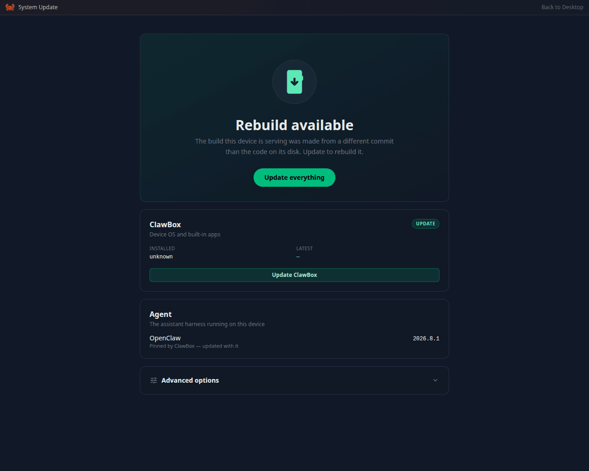

Keeping your ClawBox current gets you the newest features and fixes. Updates never touch your
data — settings, AI keys, chats, and channel tokens live outside the app code and are preserved.

<Frame caption="The System Update app: what is installed, what is waiting, and one button to take it">
  
</Frame>

## Update from the ClawBox screen (recommended)

<Steps>
  <Step title="Open System Update">
    Open the **System Update** app on the desktop, or **Settings → System Update** — they are the
    same screen. It shows two rows, **ClawBox** (the device OS and built-in apps) and **Agent**
    (the assistant harness), each with what is installed and what is available. **Check for
    updates** asks again.
  </Step>
  <Step title="Start the update">
    Click **Update everything** (or the button on one row). If agents are at work, the box asks
    first — see [When agents are running](#when-agents-are-running).
  </Step>
  <Step title="Follow it to the end">
    The screen turns into the update itself: the steps it runs, ticked off as they finish
    (**3 / 9 steps complete**), and beside them **What's new in ClawBox &lt;version&gt;** for the
    version being installed. On a beta box it names the build it installs. Don't power the box
    off until it finishes.
  </Step>
  <Step title="Let it come back">
    At the end ClawBox **restarts its services** — the screen says **Restarting — not answering
    yet** for a minute or two. That's normal, not a hang; the page reconnects by itself and returns
    to the desktop with **Update complete**. The box **reboots** only when the update brought
    something only a fresh boot applies (a JetPack or kernel upgrade, or a system library that
    asks for one), which takes a little longer.
  </Step>
</Steps>

## When agents are running

An update stops the assistant's gateway and restarts the box's web server. Agent work running at
that moment — a coding run, a sub-agent, a delegated task, a chat reply being written — would be
cut off mid-task. So when you press **Update**, the box first counts the agent runs that are
active. If there are any, nothing starts and a dialog says:

> **Agents are working right now**
> 3 agent runs are active. The update stops them mid-task. Wait until they finish, or update anyway.

- **Cancel** leaves everything running. Try again once the work has finished — the Coding Agent
  shows which runs are still working.
- **Update anyway** starts the update now; the runs it stops have to be started again afterwards.

The box counts the Coding Agent's live runs and the OpenClaw assistant's sessions that have a
run active or queued. The check is a warning, never a lock: if the OpenClaw gateway does not
answer within a few seconds (it is stopped or still starting, or the box runs Hermes), its
sessions count as idle and only the coding runs are counted. Resuming an update that was
interrupted never asks.

<Note>
The assistant cannot start a system or OpenClaw update on its own. When it asks to update from
the chat, you get a confirmation to approve first.
</Note>

## If an update stops

- **The box restarted or lost power mid-update.** System Update says which step was running when
  it stopped, and shows **Resume update**, which continues from that step. When no step is known
  the button reads **Start the update again**. **Dismiss** clears the result, and the next update
  starts from the top.
- **A step failed.** The screen shows **Update failed**, marks the step in red and says why. The
  box's code is put back to match the build it is still running, so it is never left with new
  code under an old build. Run the update again; if it stops at the same step, see
  [Troubleshooting](/support/troubleshooting#an-update-is-stuck-failed-or-rolled-back).
- **It is taking much longer than usual.** The screen says so, and that nothing has been lost. If
  the box does not come back on its own, restart it — the desktop unlocks by itself on the next
  start.

## Choosing what the box follows

A box offers the newest release on the branch it follows: the branch set for it, else the branch
it is checked out on, else `main`, the release channel. **System Update → Advanced options**
shows which, and holds:

- **Beta channel** — pulls updates from `beta` instead of `main`. Pre-release features land there
  first, so expect rough edges.
- **Branch override** — pins updates to a specific branch. Leave it blank to follow the channel.
- **Force full update** — re-runs OpenClaw and system-service setup even when the version is
  current. Use it if a recovery step told you to, or if the assistant or services misbehave after
  an update.

On `main` an update is offered by its release name (`v4.3.0`); on any other branch it is named by
its commit.

<Warning>
**Going back is not always possible.** From 4.3, the update moves OpenClaw's data to the newer
format OpenClaw 2026.10.6 and later use, and that move is one-way. A branch switch — or any update
— that would install an **older** OpenClaw or Hermes than the one that wrote the box's data is
refused before anything changes, and System Update says why. Stay on the branch you are on, or
move to one that carries the same or a newer harness. If you really must go back, the refusal offers
**Back up and update anyway**: the box backs up the assistant's data first and starts the older
version with fresh databases — see [Going back to an older release](/technical/update-system#going-back-to-an-older-release).
</Warning>

<Tip>
Before a big update you can keep a dated copy of the assistant's settings yourself (over SSH or
in the Terminal app) — on OpenClaw:

```bash
cp -r ~/.openclaw ~/.openclaw.backup-$(date +%F)
```

A [ClawKeep](/support/troubleshooting#clawkeep-backup-and-restore) backup covers the same and more.
</Tip>

## Update over SSH (OpenClaw edition)

Same update, no browser needed:

```bash
ssh clawbox@YOUR_BOX_IP        # your system password from setup
sudo bash /home/clawbox/clawbox/install.sh
```

The password prompt won't show characters as you type — that's normal. Let the installer finish
completely (it prints numbered steps). Like the in-app update, it reboots only when the update
needs a boot; otherwise it restarts the ClawBox services.

<Note>
There is **no `clawbox` command on `PATH`**. The CLI wrapper exists in the checkout and is
run through Bun — `bun run /home/clawbox/clawbox/mcp/clawbox-cli.ts update` — but all it
does is re-run `install.sh` with `sudo`, so calling the installer directly is equivalent
and works in a non-interactive SSH session too.

On a [Hermes](/editions/hermes) box, update from **Settings → System Update**: the CLI refuses,
because re-running the OpenClaw-edition installer path by hand is not how a Hermes box updates.
</Note>

## An update got stuck, or the box misbehaves afterward

If System Update itself cannot run — for example the update stalls because the box has local
code changes — the **recovery updater** is a standalone one-liner that hard-syncs the box and
rebuilds everything, keeping your data:

<Steps>
  <Step title="Connect over SSH">
    ```bash
    ssh clawbox@YOUR_BOX_IP
    ```
    Use the device's **IP address** rather than `clawbox.local` — the name relies on mDNS, which many Windows machines and routers handle unreliably (find the IP in your router's connected-devices list). The Terminal app on the desktop works too.
  </Step>
  <Step title="Run the recovery updater">
    ```bash
    bash <(curl -fsSL https://raw.githubusercontent.com/ID-Robots/clawbox/main/scripts/force-update.sh)
    ```
    It syncs to `main`, the release channel. On a box that follows beta, say so — otherwise it
    would try to move the box back to the older release:

    ```bash
    CLAWBOX_BRANCH=beta bash <(curl -fsSL https://raw.githubusercontent.com/ID-Robots/clawbox/main/scripts/force-update.sh)
    ```
    Takes 10–15 minutes — let it finish completely.
  </Step>
  <Step title="Confirm it's back">
    ```bash
    systemctl is-active clawbox-setup clawbox-gateway     # OpenClaw edition
    systemctl is-active clawbox-setup && hermes gateway status   # Hermes edition
    ```
    The services should print `active` (on Hermes, `hermes gateway status` should say the gateway is running). Then reload `http://YOUR_BOX_IP` and send your assistant a message — a reply confirms everything is running.
  </Step>
</Steps>

More recovery options (password reset, safe reinstall, factory reset) are on the [Recovery](/support/recovery) page; deeper diagnosis lives in [Troubleshooting](/support/troubleshooting#an-update-is-stuck-failed-or-rolled-back). For how updates work under the hood (release channels, what survives, version pinning), see the [Update System](/technical/update-system) reference.

<Warning>
If any step returns an error, stop there rather than forcing it — reach out and we'll finish it together: email [yanko@idrobots.com](mailto:yanko@idrobots.com) or join our [Discord community](https://discord.gg/vsTsaY4Tuk).
</Warning>
