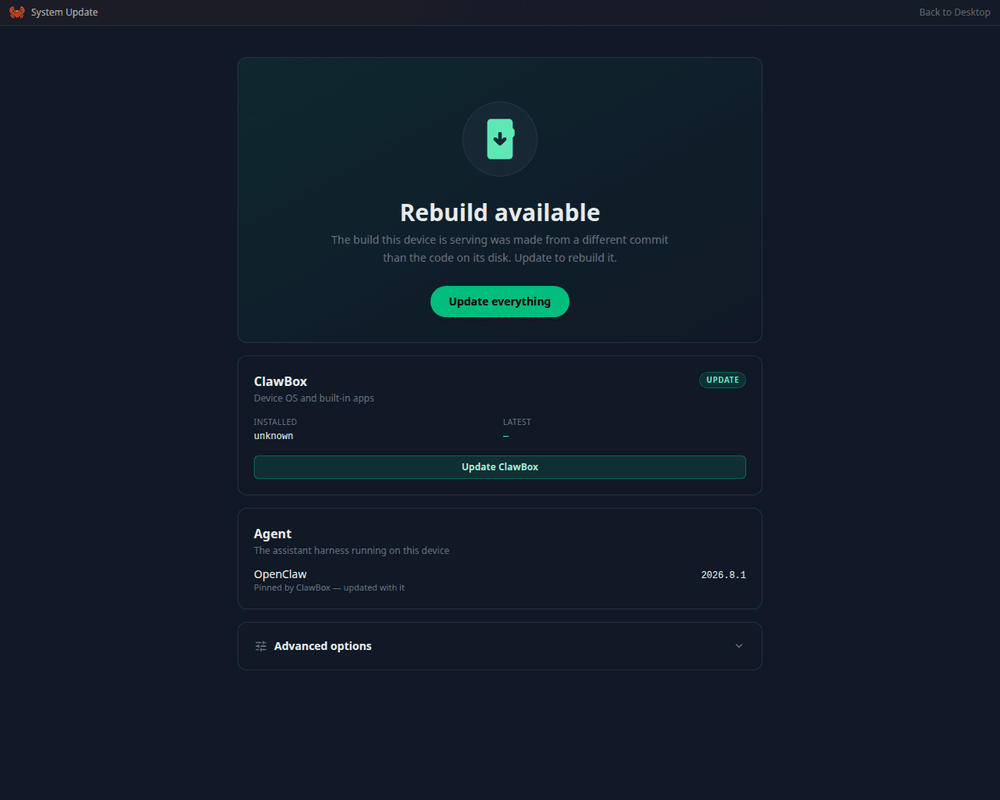
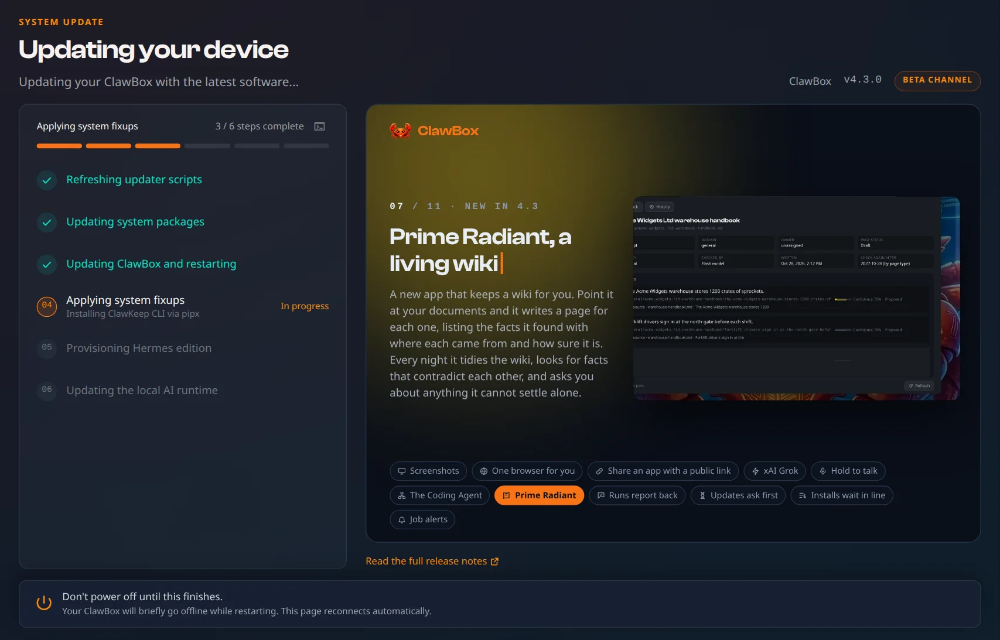
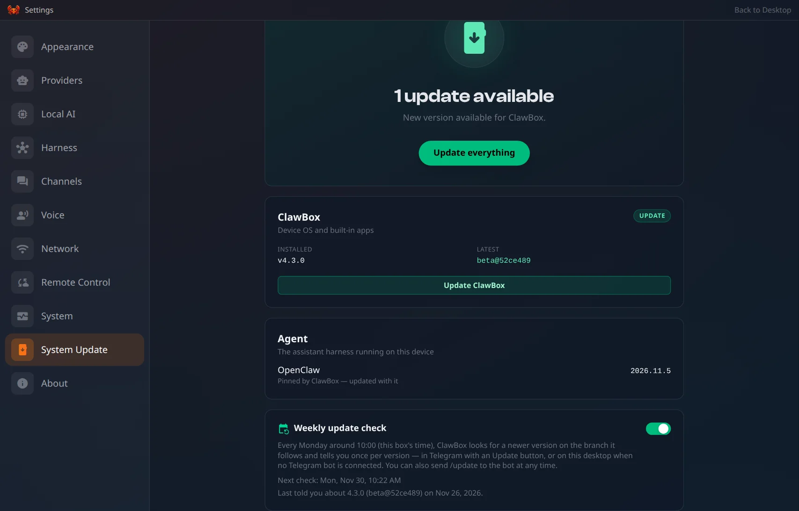
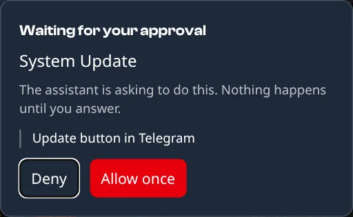
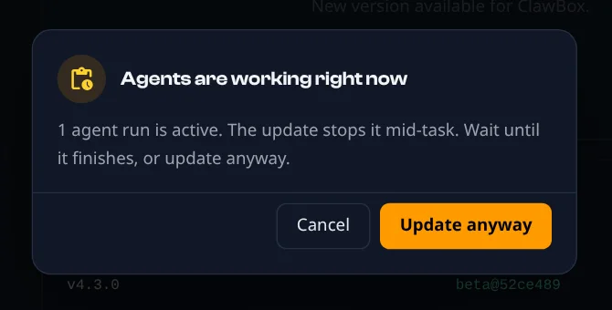

An update gives your ClawBox new features and fixes. This page is for the owner of the box, on
both editions, OpenClaw and Hermes. An update keeps your data: settings, AI keys, chats and
channel tokens stay as they are.

<Frame caption="The System Update app: what is installed, what is waiting, and one button to take it">
  
</Frame>

## Before you start

- Sign in to the ClawBox desktop with the owner account. Members of staff cannot update the box.
- The box needs internet while it updates. It is offline for a few minutes near the end.
- To update from Telegram, a Telegram bot must be connected to the box and your own Telegram
  account approved for it. See [Messaging channels](/guides/messaging-channels).

## Update from the ClawBox screen

<Steps>
  <Step title="Open System Update">
    Open **Settings**, then **System Update**. The **System Update** app in the app list opens
    the same screen. When a new version is ready, the desktop also shows a card
    **Update available**: click **View update** to get here.

    At the top you see **1 update available**. If you see **You're up to date** instead, there
    is nothing to install. **Check for updates** looks once more. Below are two rows,
    **ClawBox** (the device's system and built-in apps) and **Agent** (the assistant that runs
    on the box). The **ClawBox** row shows what is installed and what is available. The
    **Agent** row shows the version installed; it is updated together with ClawBox.
  </Step>
  <Step title="Start the update">
    Click **Update everything**. The **Update ClawBox** button on the **ClawBox** row does the
    same. If agents are working, the box asks you first. See
    [When agents are running](#when-agents-are-running).
  </Step>
  <Step title="Wait for it to finish">
    The screen says **Updating your device**. It lists the steps and ticks each one off, for
    example **3 / 6 steps complete**. Beside the steps you see what the new version brings. Do
    not turn the box off.

    <Frame caption="An update on its way: the steps on the left, what is new on the right">
      
    </Frame>
  </Step>
  <Step title="Let it come back">
    Near the end the box restarts. For a minute or two the screen says
    **ClawBox is restarting and is not answering yet. This screen will return to the desktop on its own.**
    That is normal. Wait, and the desktop comes back by itself.
  </Step>
</Steps>

## The weekly update check

Every Monday around 10:00, on the box's own clock, ClawBox looks for a newer version. When it
finds one, it tells you once about that version. The check is on by default, on both editions.

<Steps>
  <Step title="Find the card">
    Open **Settings**, then **System Update**. Below the **ClawBox** and **Agent** rows is the
    card **Weekly update check**. It says when the box looks next, for example
    **Next check: Mon, Nov 30, 10:22 AM**.

    <Frame caption="Settings → System Update with the Weekly update check card at the bottom">
      
    </Frame>
  </Step>
  <Step title="Turn it off or on">
    Click the switch **Check for updates every week**. When it is off, the card says
    **Off: the box does not look for updates on its own.** Click it again to turn it back on.
  </Step>
</Steps>

Where the box tells you:

- **In Telegram**, when a Telegram bot is connected and your account is approved for it. You get
  a message with an **Update** button. See [Update from Telegram](#update-from-telegram).
- **On the ClawBox desktop**, when no Telegram bot is connected, or the Telegram message reached
  nobody. A notice says which version is available. Click **Open Settings → System Update** on it to go to the update screen.

After it has told you, the card says which version it told you about, and on which day.

## Update from Telegram

You can start an update from your phone, on both editions. The bot only asks. Nothing is
installed until you confirm.

<Steps>
  <Step title="Get the message">
    Wait for the weekly message, or send **/update** to the bot at any time, in your own private
    chat with it. The box looks for a new version right away.

    - Nothing new: the bot answers that ClawBox is up to date.
    - A new version: the bot says which version is ready and which one the box runs now. When
      the release has highlights, it lists up to three of them under **What's new:**. It ends with "Tap Update to install it. The
      box asks you to confirm first and is offline for a few minutes while it updates." An
      **Update** button is under the message.
  </Step>
  <Step title="Tap Update">
    Tap **Update** under the message. The button goes away, and the bot answers:

    > Update requested. Confirm it on the ClawBox desktop within 2 minutes.
  </Step>
  <Step title="Confirm on the desktop">
    At the bottom right of the ClawBox desktop a card **Waiting for your approval** appears, with
    **System Update** and **Update button in Telegram** on it. Click **Allow once**. To stop,
    click **Deny**.

    <Frame caption="The question on the desktop after a tap on Update in Telegram">
      
    </Frame>

    If you connected an approvals bot (**Approve from Telegram** in **Settings → Channels →
    Email**), the bot's answer tells you to confirm with the button the approvals bot just sent
    you, or on the desktop. The approvals bot asks "Install the ClawBox software update now?"
    with **Update** and **Cancel**. Tap **Update** there, or click **Allow once** on the
    desktop. Either way, answer within 2 minutes.
  </Step>
  <Step title="Let it update">
    The update starts. The box and the bot are offline for a few minutes. On the desktop you can
    follow it, as in [Update from the ClawBox screen](#update-from-the-clawbox-screen).
  </Step>
</Steps>

## When agents are running

An update stops the work your agents are doing. A coding run, a sub-agent, a delegated task or a
chat reply being written would stop in the middle. So before it starts, the box checks for work
that is still running.

On the ClawBox screen, when you click **Update everything** and agents are working, nothing starts
yet and a dialog says:

> **Agents are working right now**
> 3 agent runs are active. The update stops them mid-task. Wait until they finish, or update anyway.

<Frame caption="The question before an update would stop work in progress">
  
</Frame>

- **Cancel** leaves everything running. Try again when the work is done. The Coding Agent shows
  which runs are still working.
- **Update anyway** starts the update now. You start the stopped runs again afterwards.

In Telegram, a tap on **Update** while agents are working asks nothing. The bot answers:

> Agents are working right now (1 active), and the update would stop them mid-task. Tap Update again when they finish, or use Update anyway in Settings → System Update.

On OpenClaw the box counts the Coding Agent's runs and the assistant's own work. On Hermes it
counts only the Coding Agent's runs, so a chat reply that is being written does not hold the
update back.

<Note>
The assistant cannot start a system or OpenClaw update on its own. When it asks to update from the
chat, you get a confirmation to approve first.
</Note>

## If it does not work

- **The box restarted or lost power during the update.** System Update says which step was
  running when it stopped, and shows **Resume update**. That continues from that step. When no
  step is known, the button says **Start the update again**. **Dismiss** clears the result, and
  the next update starts from the top.
- **A step failed.** The screen says **Update failed**, marks the step in red and says why. Click
  **Try again**. If it stops at the same step, see
  [Troubleshooting](/support/troubleshooting#an-update-is-stuck-failed-or-rolled-back).
- **It takes much longer than usual.** The screen says so, and that nothing has been lost. If the
  box does not come back by itself, restart it. The desktop unlocks by itself on the next start.
- **The bot answers /update with a pairing code.** Your Telegram account is not approved for the
  bot yet. Approve it on the ClawBox screen, then send **/update** again.
- **/update in a group does nothing.** Send it in your private chat with the bot. On Hermes the
  bot tells you so in your private chat. On OpenClaw it does not answer in the group at all.
- **The bot says the box is already waiting for you to confirm something else, or you just
  declined.** Answer the question on the desktop first, or wait a minute and tap **Update**
  again. After a **Deny**, the box waits one minute before it asks again.
- **You did not answer within 2 minutes.** The question goes away and nothing is installed. Tap
  **Update** again.
- **The bot says there is nothing to install.** The box is already up to date. The button came
  from an older message.
- **The bot says ClawBox could not reach the update server.** Check the box's internet
  connection, then send **/update** again later.

## Details

### How agent runs are counted

An update stops the assistant's gateway and restarts the box's web server, so agent work running
at that moment is cut off. The box counts the Coding Agent's live runs and the OpenClaw assistant's sessions that have a run
active or queued. The check is a warning, never a lock: if the OpenClaw assistant does not answer
within a few seconds (it is stopped or still starting, or the box runs Hermes), its sessions
count as idle and only the coding runs are counted. Resuming an update that was interrupted never
asks.

### How the weekly check works

- Each box has its own fixed minute between 10:00 and 11:00 on Monday, so not every box asks at
  the same moment.
- If the box was off on Monday morning, it checks once when it next starts that week.
- If it could not reach the update server, it tries again every hour for the rest of that week.
- It uses the same check as the System Update screen, on the branch the box follows (see below).
  It tells you about each version once. A version it already told you about is not sent again.
- In Telegram, each account approved for the box's bot gets the message, up to five. If none of
  them can be reached, the box shows the notice on the desktop instead.
- The messages are in the box's language.
- **/update** and the **Update** button work only for Telegram accounts approved for the bot, and
  only in a private chat with it. An account that is not approved gets the bot's own pairing
  answer, and nothing else happens.
- **/update** sends the same message as the weekly check, so Monday's check does not send that
  version again.
- Only the owner can turn the weekly check on or off.

### Choosing what the box follows

A box offers the newest release on the branch it follows: the branch set for it, else the branch
it is checked out on, else `main`, the release channel. **System Update → Advanced options**
shows which, and holds:

- **Beta channel** pulls updates from `beta` instead of `main`. Pre-release features land there
  first, so expect rough edges.
- **Branch override** pins updates to a specific branch. Leave it blank to follow the channel.
- **Force full update** runs OpenClaw and system-service setup again even when the version is
  current. Use it if a recovery step told you to, or if the assistant or services misbehave after
  an update.

On `main` an update is offered by its release name (`v4.3.0`); on any other branch it is named by
its commit.

<Warning>
**Going back is not always possible.** From 4.3, the update moves OpenClaw's data to the newer
format OpenClaw 2026.10.6 and later use, and that move is one-way. A branch switch, or any update,
that would install an **older** OpenClaw or Hermes than the one that wrote the box's data is
refused before anything changes, and System Update says why. Stay on the branch you are on, or
move to one that carries the same or a newer harness. If you really must go back, the refusal offers
**Back up and update anyway**: the box backs up the assistant's data first and starts the older
version with fresh databases. See [Going back to an older release](/technical/update-system#going-back-to-an-older-release).
</Warning>

<Tip>
Before a big update you can keep a dated copy of the assistant's settings yourself (over SSH or
in the Terminal app). On OpenClaw:

```bash
cp -r ~/.openclaw ~/.openclaw.backup-$(date +%F)
```

A [ClawKeep](/support/troubleshooting#clawkeep-backup-and-restore) backup covers the same and more.
</Tip>

### How an update ends

On a beta box the update screen names the build it installs. At the end ClawBox **restarts its
services**, and the screen shows **Update complete** before it returns to the desktop. The box
**reboots** only when the update brought something only a fresh boot applies (a JetPack or kernel
upgrade, or a system library that asks for one), which takes a little longer.

When a step fails, the box's code is put back to match the build it is still running, so it is
never left with new code under an old build. **Try again** runs the update again; an update the
box lost part of the way through still continues where it stopped.

### Update over SSH (OpenClaw edition)

Same update, no browser needed:

```bash
ssh clawbox@YOUR_BOX_IP        # your system password from setup
sudo bash /home/clawbox/clawbox/install.sh
```

The password prompt won't show characters as you type. That's normal. Let the installer finish
completely (it prints numbered steps). Like the in-app update, it reboots only when the update
needs a boot; otherwise it restarts the ClawBox services.

<Note>
There is **no `clawbox` command on `PATH`**. The CLI wrapper exists in the checkout and is
run through Bun (`bun run /home/clawbox/clawbox/mcp/clawbox-cli.ts update`), but all it
does is run `install.sh` again with `sudo`, so calling the installer directly is the same
and works in a non-interactive SSH session too.

On a [Hermes](/editions/hermes) box, update from **Settings → System Update**: the CLI refuses,
because running the OpenClaw-edition installer path by hand is not how a Hermes box updates.
</Note>

### An update got stuck, or the box misbehaves afterward

If System Update itself cannot run, for example because the update stalls on local code changes
on the box, the **recovery updater** is a standalone one-liner that hard-syncs the box and
rebuilds everything, keeping your data:

<Steps>
  <Step title="Connect over SSH">
    ```bash
    ssh clawbox@YOUR_BOX_IP
    ```
    Use the device's **IP address** rather than `clawbox.local`. The name relies on mDNS, which many Windows machines and routers handle unreliably (find the IP in your router's connected-devices list). The Terminal app on the desktop works too.
  </Step>
  <Step title="Run the recovery updater">
    ```bash
    bash <(curl -fsSL https://raw.githubusercontent.com/ID-Robots/clawbox/main/scripts/force-update.sh)
    ```
    It syncs to `main`, the release channel. On a box that follows beta, say so. Otherwise it
    would try to move the box back to the older release:

    ```bash
    CLAWBOX_BRANCH=beta bash <(curl -fsSL https://raw.githubusercontent.com/ID-Robots/clawbox/main/scripts/force-update.sh)
    ```
    It takes 10 to 15 minutes. Let it finish completely.
  </Step>
  <Step title="Confirm it's back">
    ```bash
    systemctl is-active clawbox-setup clawbox-gateway     # OpenClaw edition
    systemctl is-active clawbox-setup clawbox-hermes-dashboard   # Hermes edition
    ```
    Both should print `active`. Then reload `http://YOUR_BOX_IP` and send your assistant a message. A reply confirms everything is running.
  </Step>
</Steps>

More recovery options (password reset, safe reinstall, factory reset) are on the [Recovery](/support/recovery) page; deeper diagnosis lives in [Troubleshooting](/support/troubleshooting#an-update-is-stuck-failed-or-rolled-back). For how updates work under the hood (release channels, what survives, version pinning), see the [Update System](/technical/update-system) reference.

<Warning>
If any step returns an error, stop there rather than forcing it. Reach out and we'll finish it together: email [yanko@idrobots.com](mailto:yanko@idrobots.com) or join our [Discord community](https://discord.gg/vsTsaY4Tuk).
</Warning>
