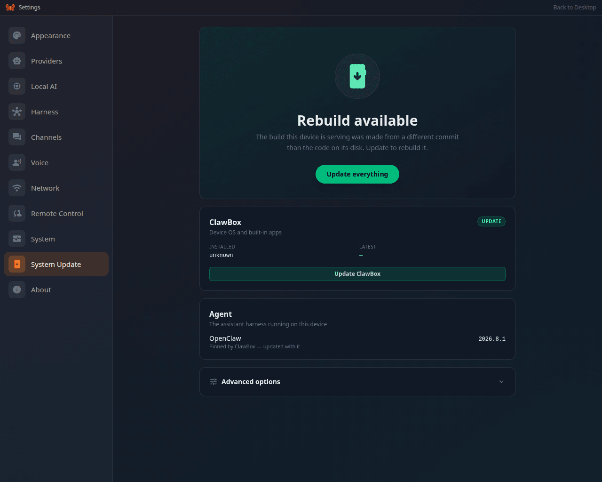

ClawBox updates are **git-based**: the device tracks the [ID-Robots/clawbox](https://github.com/ID-Robots/clawbox) repository and follows one branch of it — `main`, the release channel, unless the box records another. A release is a `vX.Y.Z` tag on `main`. The updater hard-syncs the code to the tip of the branch the box follows and rebuilds in place.

<Frame caption="Settings → System Update, the same pipeline seen from the settings panel">
  
</Frame>

## How the device decides an update exists

1. **Resolve the branch it follows**: the branch recorded in `.update-branch`, else the branch the checkout is on, else `main` (see [Update channels](#update-channels)).
2. **Ask origin, twice and anonymously**: the release tags (`git ls-remote`, only `vX.Y.Z` counts) and a fetch of the followed branch. There is deliberately no `git fetch --tags`.
3. **Offer what the box is behind.** On `main` the update is offered by its release name (`v4.3.0`) when a newer tag exists; on any other branch, or on a `main` that moved on with no newer tag, it is named by the commit it installs (`beta@1a2b3c4`). A box whose served build was made from a different commit than its checkout is offered a **Rebuild**.
4. The "Installed" version is read from `package.json`; OpenClaw's target version comes from the pin file `config/openclaw-target.txt` (2026.10.9 on 4.3), Hermes Agent's from `install.sh` (v0.22.5 on 4.3). On a Hermes box the OpenClaw half reports nothing to update.

A check that reached origin is cached for 30 minutes (a refusal for 60 seconds); **Check for updates** (`?force=1`), a finished update or a change of branch drops the cache. A check that could not reach origin reports **Couldn't reach the update server** rather than "up to date".

## The update pipeline

Started from the **System Update** app (or Settings → System Update, the same screen). Steps, in order — each privileged step runs as a `clawbox-root-update@<step>` systemd unit, and a step that does not apply to the box (an OpenClaw step on Hermes, the Jetson runtime on x64) is left out of the list:

| Step | What it does |
|---|---|
| `bootstrap_updater` | Refreshes `install.sh` itself from origin first (so the rest runs the *new* updater) |
| `apt_update` | System packages |
| `chromium_install` / `vnc_install` | Desktop browser + remote display stack |
| `openclaw_install` | OpenClaw core → **pinned** version from `config/openclaw-target.txt`, plus re-pins all `@openclaw/*` plugins to match (the fleet never floats on `@latest` — version skew between core and the `@openclaw/codex` plugin breaks ChatGPT-subscription chats; pin bumps ship via the normal PR → beta → release flow). When nothing would change — core already at the pin, ClawBox's plugins at their pins and healthy, the last full run recorded for this pin in `/etc/clawbox/openclaw-refresh`, doctor's last run for this core complete and its databases recorded as current — none behind or ahead of the core's schema, no migration blocked (`data/openclaw-migration-status.json`), gateway serving — the update takes a fast path that leaves the gateway running; the journal says `OpenClaw refresh: fast path (…)` or `full path (…)` with the reason. Force the full path with `sudo CLAWBOX_FORCE_OPENCLAW_REFRESH=1 bash install.sh --step openclaw_install` |
| `openclaw_patch` | Applies ClawBox's gateway patches |
| `gateway_setup` | (Re)installs the gateway service file + drop-ins (OpenClaw / dual) |
| `restart` | **The hard-sync + rebuild** ("Updating ClawBox and restarting"): `git fetch` → `git reset --hard HEAD` → checkout channel branch → `git reset --hard origin/<channel>` → `git clean -fd` → full `bun install` + `next build` (followed by `scripts/verify-build-identity.sh`) → **restart the services, or reboot only when something needs a boot** |
| `post_update` | Fixups (hostname, dispatcher, smoke checks, the hotspot restart when its scripts changed) — advisory |
| `hermes_edition` | Provisions the Hermes edition (Hermes / dual) |
| `gateway_verify` | Proves the OpenClaw gateway serves a chat session, not only `/healthz` (OpenClaw / dual) |
| `llamacpp_runtime` | Keeps the on-device model's `llama-server` at its pinned build (Jetson) |

Key properties:

- **`git clean -fd` (no `-x`)** — gitignored paths are never touched, which is what preserves `data/`, `.env`, `node_modules`, and your state. See [what survives](/technical/filesystem#what-survives-what).
- **A reboot only when something needs a boot.** The update reboots when Ubuntu asks for one (`/var/run/reboot-required`, set by a JetPack, kernel or core-library upgrade), when the kernel, initrd, bootloader config or device tree changed since boot, or when the running kernel's modules are gone. Otherwise it restarts every active `clawbox-*` service, starts every enabled one that is not running, and names any that did not come back as a warning on the update screen. Either way, expect a minute or two of unreachability; `/updating` keeps asking and returns to the desktop by itself.
- After the restart, completion is only reported if the build fingerprint (`.next/BUILD_ID`) actually changed and the rebuild unit succeeded — a failed rebuild surfaces as a failed step, not a silent "complete". A failed update puts the checkout back to the commit of the build the box is still serving.
- **An interrupted update resumes.** The update lock records the step the run is on at every boundary. A run cut short by a reboot or power loss is reported with that step, and **Resume update** (`POST /setup-api/update/run` again) continues from it rather than from the top.
- **The assistant cannot start one by itself.** The agent's MCP bearer gets `202 pendingApproval` from `update/run`, and the update runs only after the owner confirms it.

## Running agents are asked about first

An update stops the OpenClaw gateway and restarts the setup server, which kills a sub-agent, an ACP run, a coding run or a chat turn in flight. So `POST /setup-api/update/run` first counts the work running now (`src/lib/update-busy.ts`): the Coding Agent's live runs, plus the gateway sessions with a run active or queued (`sessions.list` with `activeOnly`, given 3 seconds to answer). When the total is above zero it starts nothing and answers:

```json
HTTP 409
{ "started": false, "busy": true, "work": { "coding": 1, "agents": 2, "total": 3 } }
```

System Update turns that into the **Agents are working right now** dialog — *"3 agent runs are active. The update stops them mid-task. Wait until they finish, or update anyway."* — with **Cancel** and **Update anyway**. **Update anyway** posts again with `{ "ignoreBusy": true }`. A gateway that does not answer (stopped, booting, or masked on a Hermes box) counts as no work, so the check can never be the reason an update cannot start, and a resume from `/updating` never asks.

## Build identity and drift

`.next/BUILD_ID` proves two asset sets differ; it never says which source produced them. So every build also writes **`.next/build-info.json`** (commit, short commit, branch, dirty flag, build time, the `BUILD_ID` it belongs to, node/bun versions, the Hermes and OpenClaw pins) via `scripts/write-build-info.mjs`, and the postbuild step copies it into `.next/standalone/.next/` — the tree the service actually runs from.

The same postbuild step also **deletes `.next/standalone/data`**. Next's file tracing follows the `data/` paths in the middleware and the instrumentation hook into the standalone bundle, and its own `outputFileTracingExcludes` only reaches route entries, so a build otherwise leaves a multi-gigabyte second copy of your `data/` tree — model weights, webapps and all — inside a build artifact that nothing reads (the service runs from `/home/clawbox/clawbox`, so every reader resolves `data/` there). Expect `.next/standalone` to shrink by the size of `data/` on the first update that includes this.

`GET /setup-api/system/build-identity` compares three things that are not assumed to agree:

| | |
|---|---|
| **deployed build** | the commit stamped into the build the box is serving |
| **checkout** | `git rev-parse HEAD` in `/home/clawbox/clawbox` |
| **pin** | the tested branch in `.update-branch` |

It returns a `drift` object (`buildVsCheckout`, `checkoutVsPin`, `detected`, plus plain-language `reasons` and machine-readable `codes`). Settings → **About** shows the commit, branch and build time; **About** and **System** raise a warning banner as soon as drift is detected.

Drift does **not** block an update. When the updater finds it, the update:

1. **warns** — one line per problem, in the update log and the journal;
2. **auto-repins** — a box with no usable `.update-branch` is pinned to the branch the update resolved, so the next one is repeatable (an operator's existing pin is never overwritten);
3. **rebuilds**, then **verifies**: `install.sh` runs `scripts/verify-build-identity.sh` right after `bun run build`, so a build that cannot be traced to the commit checked out fails the rebuild loudly rather than serving 404s for features whose code is on disk.

The same script runs in CI (`.github/workflows/build-identity.yml`), so a pull request whose build cannot be traced back to its own commit goes red.

## Update channels

The channel is a one-line file: `/home/clawbox/clawbox/.update-branch` (absent = `main`).

- **`main`** — stable releases. Default.
- **`beta`** — the integration branch, for early adopters and testing fixes ahead of release.

Switch in **System Update → Advanced options** (Beta toggle / branch override), or over SSH: `echo beta > /home/clawbox/clawbox/.update-branch`. The pin survives updates **and** factory resets; clear it from the same UI or by deleting the file. All update mechanisms (UI, installer, recovery script) honor it.

With no pin recorded (file absent or empty) the box follows the branch it is checked out on, and `main` otherwise, so it still sees new releases. **Advanced options** shows the branch updates actually follow and whether it was recorded. The one exception is a detached checkout that nothing on the box ties to a branch. The update check still compares it against `main`, but the update itself refuses to guess a channel and asks for a branch to be entered first.

## Going back to an older release

OpenClaw and Hermes Agent move their data forward and never back. Once a box has run a newer version, an older one cannot open what it wrote. For example, OpenClaw 2026.10.6 moves the agent databases to schema 25, and 2026.10.3 reads up to schema 24. So a switch that would install an **older** harness than the one installed now is refused, and nothing on the box changes. This covers switching from `beta` to a `main` that still pins the older release, or any rollback. The check runs:

- **when you set the update branch** (Beta toggle or branch override): the branch on record stays as it was;
- **when you press Update now**: the update stops before its first step;
- **in `install.sh`**, before it resets the checkout to the branch and again before it replaces the OpenClaw core. An older core is never put in place over newer databases, and the gateway keeps running on the core the box had.

The check reads the target branch's pins (`config/openclaw-target.txt` and `HERMES_PIN_COMMIT` in `install.sh`) without checking anything out. It compares them with the versions installed now and with the schema of every OpenClaw database on disk (the state database and each agent database). It refuses only on proof. If a pin or a database cannot be read, the check stands down. A harness with no database on disk has nothing an older version could fail to open, so the check lets it through.

**The override.** The refusal offers **Back up and switch anyway** (update branch) and **Back up and update anyway** (Update now). Choosing it on the update branch records the branch, and the update then asks for the same choice. When the update runs with the override, it:

1. backs up the assistant's data **first**: a ClawKeep backup when the box is paired with ClawKeep, otherwise the harnesses' own `openclaw backup create --verify --no-include-workspace` and `hermes backup`, written to `~/clawbox-harness-backups/<UTC time>/`. If the backup fails, nothing is installed;
2. records `data/harness-downgrade.json`, which lets the installer go ahead with exactly that older OpenClaw for twelve hours;
3. installs the older version. The OpenClaw databases it cannot open are moved, unedited, into `~/clawbox-harness-backups/<UTC time>/openclaw-newer-schema/`, and it starts with fresh ones. Their conversations stay in the backup and come back when you return to the newer release and restore it.

Over the API the override is `"allowHarnessDowngrade": true` in the body of `POST /setup-api/system/update-branch` or `POST /setup-api/update/run`. Only a literal `true` counts.

## Ways to update

| Method | What it runs | When to use |
|---|---|---|
| **System Update app** (UI) | The full pipeline above | Normal case |
| `sudo bash install.sh` (SSH) | Full `install.sh` in place | Headless/remote maintenance, and after manual git operations |
| `bun run /home/clawbox/clawbox/mcp/clawbox-cli.ts update` | Wrapper that re-runs `install.sh` with `sudo` | Same thing from the Terminal app. **OpenClaw/dual only** — refused on Hermes. There is no `clawbox` command on `PATH` |
| `bash <(curl -fsSL …/scripts/force-update.sh)` | Standalone hard-sync + rebuild | When the updater itself is broken — see [Recovery](/support/recovery#c--safe-reinstall-1015-minutes-no-data-loss) |

<Warning>
**A manual `git pull` + service restart is *not* an update.** It skips `openclaw_install` (core version pin) and `gateway_setup` (service files) — the two most common sources of "updated but broken" states: `gateway token mismatch` errors and `Config validation failed: Unrecognized key`. If you touched the checkout manually, finish with a full `sudo bash install.sh`. Details: [Troubleshooting](/support/troubleshooting#update-finished-but-the-box-misbehaves).
</Warning>

## Local changes to the checkout

The update **hard-syncs** the checkout: `reset --hard` to `origin/<branch>` and `git clean -fd`. Local commits and edits to tracked files under `/home/clawbox/clawbox` are discarded on every update, so they can no longer hold a box back from its updates — there is no "Updates paused" state any more. Gitignored paths (`data/`, `.env`, `node_modules`) are untouched. Keep your own code in your home folder or a Coding Agent project, never in the ClawBox checkout. The same hard-sync by hand is [Recovery → Safe reinstall](/support/recovery#c--safe-reinstall-1015-minutes-no-data-loss).

## Related endpoints

| Endpoint | Purpose |
|---|---|
| `GET /setup-api/update/versions` | Installed/target versions (add `?force=1` to bypass the cache) |
| `POST /setup-api/update/run` | Start the full update, or resume an interrupted one. Answers `409 { busy: true, work }` while agent work runs; `{ "ignoreBusy": true }` updates anyway, and `{ "allowHarnessDowngrade": true }` is the [override](#going-back-to-an-older-release) for an update that installs an older harness |
| `GET /setup-api/update/status` | Live step progress (polled by the UI and `/updating`) |
| `POST /setup-api/update/dismiss` | Clear a finished or failed result, so the next run starts from the top |
| `POST /setup-api/update/request` | The assistant's request to update, held until the owner confirms (MCP `update_run`) |
| `GET /setup-api/update/whats-new` | The version the running update installs and the highlights of its release notes, for the update screen |
| `GET/POST /setup-api/system/update-branch` | Read/set the channel pin; both also answer `effective: { branch, source }`, the branch updates follow. A branch that would install an older harness answers `409` with `code: "harness_downgrade"` unless the body carries the override |
| `GET /setup-api/system/build-identity` | Deployed build vs checkout vs pin, with the drift verdict (add `?force=1` to bypass the 30 s cache) |
